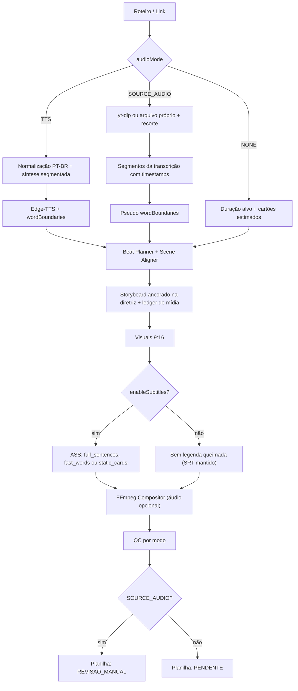

# Plano: Modos de Áudio e Legenda no Studio IA

**Versão:** 2.0
**Status:** Proposto
**Data:** 07/10/2026
**Escopo:** `pipeline/` (Node.js + FFmpeg + Edge-TTS), a ponte Java (`AiPipelineService`, `DashboardApiController`, `PipelineRunRequest`), o Studio IA (`index.html`), o publicador (`PublishStatus`, `GoogleSheetsAdapter`) e a infraestrutura (`Dockerfile`, `docker-compose.yml`)
**Supersede:** v1.0 deste arquivo (07/10/2026)
**Relacionados:** [Plano de Melhoria v2.0](Plano_Melhoria_Videos_2026-09-23.md), [ADR 0006](adr/0006-fonte-de-visuais-e-teto-de-qualidade.md), [Catálogo de Achados](Auditoria_Qualidade_Pipeline_Achados.md), [DoD](DoD.md), [GEMINI.md](../GEMINI.md)

### Relação com o Plano de Melhoria de 23/09

| Item do Plano de Melhoria | Relação com este plano |
| :--- | :--- |
| P2.4 (comprimir pausas) | **Absorvido** pela Fase 1A: a síntese segmentada substitui as pausas longas por silêncios controlados. |
| P3.1 (agrupamento prosódico, cards de 700–2200 ms) | **Mantido** no layout `fast_words`. No layout `full_sentences`, **substituído** por cards de 1,2–5,5 s (Fase 1B). |
| P3.3 (`\N` calculado por largura medida) | **Absorvido** pela Fase 1B. |
| P3.6 (SRT em caixa mista) | **Absorvido** pela Fase 1B. |
| P4.2 (SSML por bloco: gancho +12%, corpo +4%, punchline −6%) | O mecanismo por bloco é **mantido**. Os valores de `rate` são **substituídos** pela decisão D6, porque o objetivo agora é eliminar o ritmo acelerado. |
| P5.4 (ledger de roteiro) | **Complementado** pela Fase 1D, que corrige o QC-13. |
| P5.5 (grade de `shotType` rotacionados) | **Alinhado** com a rotação de enquadramentos da Fase 1D. |
| §8 (não mexer no contrato de log antes do NDJSON) | **Respeitado:** os marcadores `[1/6]`…`[6/6]` não mudam em nenhum modo. |

---

## 1. Objetivo

Ao extrair ou gerar o roteiro no Studio IA, o usuário escolhe:

| # | Capacidade | O que entrega | Aceite mensurável |
| :---: | :--- | :--- | :--- |
| 1 | **Locução** | Vídeo com ou sem narração neural (Edge-TTS). | MP4 gerado nos modos `TTS` e `NONE`, sempre com faixa de áudio (`ffprobe`). |
| 2 | **Locução ultra-natural em PT-BR** | Cadência humana: acentuação gráfica respeitada, entonação de pergunta e exclamação preservada e pausas respiratórias entre frases e blocos. Elimina o ritmo acelerado e robótico. | LRA ≥ 5 LU (hoje 2,5); 140–165 palavras/min; zero erro no checklist de 20 palavras acentuadas; pausa entre blocos de 400 ± 30 ms. |
| 3 | **Legenda** | Com ou sem legenda queimada. O SRT continua sendo gerado para CC e SEO. | Regressão `TTS` com e sem legenda. |
| 4 | **Legendas em frases completas** | Orações inteiras com sentido fechado, em 1–2 linhas, com destaque karaokê e sem fragmentação em 2–3 palavras. | Nenhum card cruza fim de frase; nenhuma linha passa da capacidade calculada; nenhum card de 1 palavra. |
| 5 | **Somente visual** | Vídeo só com imagens e clipes, mais a trilha de fundo. A legenda vira cartões de texto. | Duração ≥ 60 s; faixa de áudio presente. |
| 6 | **Áudio original do link** | Reaproveita o áudio de um vídeo do YouTube, com visuais novos gerados pela IA. **Restrito a conteúdo próprio ou licenciado** (D1). | O post nasce com o status `REVISAO_MANUAL` e não é publicado sem ação humana. |
| 7 | **Fidelidade estrita à diretriz visual** | Os sujeitos, ações e estética descritos pelo usuário (ex.: policiais em ação, soldados, combate urbano) aparecem nos takes, sem desvio para objetos genéricos secundários. | QC-14 ≥ 80% das cenas com termo-âncora; zero objeto da lista de bloqueio. |
| 8 | **Anti-repetição de mídia** | Clipes e imagens inéditos em cada take e entre vídeos sucessivos do canal, com livro-razão de mídias usadas (`used_media_ledger.json`) e paginação nas APIs de estoque. | Duas execuções seguidas com a mesma diretriz: zero `provider:id` repetido. |

---

## 2. Diagnóstico: o que o código faz hoje

Auditoria feita no working tree de 07/10/2026. As linhas citadas valem para esse estado.

### 2.1 Situação atual

| Recurso | Estado | Evidência |
| :--- | :---: | :--- |
| Toggle de legenda (`enableSubtitles`) | ✅ | Existe na Etapa 3 (`#studioEnableSubtitles`, `index.html:578`) e no [run_pipeline.js](../pipeline/src/run_pipeline.js) (`:98-101`). **Só controla a queima:** o ASS e o SRT são sempre gerados (`run_pipeline.js:310-338`; [video_compositor.js](../pipeline/src/video_compositor.js) `:108-111`). |
| Desativar locução | ❌ | O TTS é obrigatório (`run_pipeline.js:286-307`). O sintetizador lança erro com texto vazio. |
| Duração do vídeo | ❌ | Sempre a duração da locução + 0,15 s. O fallback `format.target_duration_seconds \|\| 60` só entra se a duração medida for 0 (`run_pipeline.js:342-347`). |
| Compositor sem áudio | ❌ | `audioPath` é obrigatório: o `scratchDir` e o `concat_list.txt` vêm de `path.dirname(audioPath)` (`video_compositor.js:100-105`), `.input(audioPath)` (`:136`), filtros com `[1:a]`/`[2:a]` (`:173-186`). |
| Áudio do YouTube | ❌ | O [youtube_analyzer.js](../pipeline/src/youtube_analyzer.js) só lê a transcrição e **descarta** o `offset`/`duration` de cada segmento (`:108-136`). Não baixa mídia. |
| Ritmo da voz | ⚠️ | A taxa efetiva vem do perfil do canal: de −4% (`psicosegredo`) a **+12%** (`motivacao`). O default `+5%` de `synthesizeVoiceWithTimestamps` nunca é usado, e o `--voice` força `+0%/+0Hz` (`run_pipeline.js:290-291`). |
| Prosódia e SSML | ❌ | Só `xmlEscape` ([voice_synthesizer.js](../pipeline/src/voice_synthesizer.js) `:6-14`). O `toStream` (`:46`) envolve o texto inteiro num único `<prosody>`. Não há `<break>`, normalização nem pausas. |
| Agrupamento de legenda | ⚠️ | Por pausas (`groupWordsIntoChunks`, [subtitle_generator.js](../pipeline/src/subtitle_generator.js) `:70-106`), mas o ASS fixa 3 palavras (`:198`) e quebra a linha em `ceil(n/2)` (`:234`) sem limite de caracteres. Os `wordBoundaries` do Edge **não trazem pontuação**, então a regra de pontuação quase nunca dispara. |
| Diretriz visual | ⚠️ | O texto da diretriz chega a ~26 arquivos, mas se perde no ponto decisivo (ver 2.2). |
| Dedup de mídia | ⚠️ | Só dentro do vídeo, com `Set`s em memória ([visuals_harvester.js](../pipeline/src/visuals_harvester.js) `:483-485`). Pexels e Pixabay compartilham o mesmo `Set` sem prefixo de provedor, e o ID é marcado **antes** do download ([stock_video_connector.js](../pipeline/src/stock_video_connector.js) `:293, 345, 529, 577`). Nada entre vídeos. Sem paginação (`per_page` 10/12 em `:262, 323, 504, 557`). |
| Enquadramento | ⚠️ | Existe no storyboard ([ai_storyboarder.js](../pipeline/src/ai_storyboarder.js) `:679-683`) e no beat planner, mas nunca chega às queries de estoque. |
| Novidade de roteiro | ❌ | O QC-13 compara uma string com um array de objetos e nunca reprova ([qc_gate.js](../pipeline/src/qc_gate.js) `:397-419`). O `checkNovelty` ([script_ledger.js](../pipeline/src/script_ledger.js) `:57`) nunca é chamado. |
| Revisão manual antes de publicar | ❌ | Não existe status de revisão. `PublishStatus.fromString` converte valor desconhecido em `PENDENTE` ([PublishStatus.java](../src/main/java/com/autopublisher/domain/model/PublishStatus.java) `:13-22`), e o `findPendingPosts` publica todo `PENDENTE` ([GoogleSheetsAdapter.java](../src/main/java/com/autopublisher/infrastructure/adapter/sheets/GoogleSheetsAdapter.java) `:88, 118`). A coluna O (`Log_Erro`) nem é lida pelo `parseRow`. |

### 2.2 Por que a diretriz visual não é obedecida

Três causas somadas:

1. **O storyboard Gemini não recebe o texto da diretriz.** O `generateStoryboardBatchGemini` (`ai_storyboarder.js:722-758`) só usa a diretriz para escolher um estilo (`buildLayerAWorldProfile`, `:511-515`).
2. **O próprio prompt induz o desvio.** A regra 2 (`:753`) dá como exemplo *"tying running shoes, hourglass sand, alarm clock"*. É exatamente a origem dos takes de cadarço e cronômetro.
3. **A diretriz perde prioridade.** A heurística só trata persa e samurai (`:596-603`); o resto cai em arquétipos genéricos. Nas queries de estoque, a diretriz vem **depois** das queries do storyboard (`buildSmartContextualQueries`, `stock_video_connector.js:128-249`).

### 2.3 Bugs que sabotam os objetivos (entram na Fase 0)

- **Movimentos de câmera.** Os nomes em `MOTION_VARIATIONS` ([beat_planner.js](../pipeline/src/beat_planner.js) `:9-16`: `pull_out`, `pan_left`, `orbit`…) não existem no `switch` de `createCinematicMotionClip` (`visuals_harvester.js:240-260`: `pan_left_right`, `reveal_zoom_out`…). Quase todo sub-take cai no `default` e sai como `push_in`.
- **Trilha do canal ignorada.** O `audio_profile.bg_music_track` não é lido: a trilha é o primeiro arquivo da pasta (`run_pipeline.js:420-433`). As faixas configuradas (`dark_ambient_tension_01.mp3`, `dark_ambient_loop.mp3`) nem existem em `pipeline/assets/music/`. Além disso, `bg_music_volume || 0.18` impede o volume 0 (`video_compositor.js:95-97`).
- **Tema do canal sobrescrito.** O default `subtitlesTheme: 'GOLD_PUNCH'` da CLI (`run_pipeline.js:45`) anula o `subtitles_style` do canal (`:316, 327-328`).
- **Cache local na imagem.** O `.dockerignore` não exclui `pipeline/.cache/` nem `pipeline/state/`.

### 2.4 Fatos do Java e do Studio que moldam o plano

- **`PipelineRunRequest`** é um record de 17 campos com 6 construtores encadeados e **sem validação**, embora o `spring-boot-starter-validation` esteja no `pom.xml`.
- **`/pipeline/run`** faz bind direto do record (`DashboardApiController.java:402-415`): só os nomes dos componentes do record funcionam como chave JSON.
- **`/pipeline/preview-script`** lê um `Map` à mão (`:315-341`). O `previewScript` já tem 4 sobrecargas posicionais (`AiPipelineService.java:101-122`).
- **Chaves novas no config JSON** (`AiPipelineService.java:419-439`) chegam ao Node sem flag nova, pelo merge em `run_pipeline.js:51-64`.
- **Contrato de log:** o Java faz parsing de prosa em português (`[1/6]`…`[6/6]`, `Video MP4:`, `Duracao Final:`, `Elegivel TikTok Rewards:`; `AiPipelineService.java:563-593`). O rótulo da etapa 2 está fixo em "Síntese de Voz Neural Edge-TTS" (`:565`).
- **Studio:** tem 3 Etapas. O campo de diretriz (`#studioVisualDirectiveInput`, `index.html:441`) só aparece no modo YouTube (`#studioModeYoutubeBlock`, `:391`). Não há campo de duração; a duração é estimada a 135 palavras/min.
- **Defeitos no Studio:** `onStudioNarrationUserEdit` está duplicada (`:2767` é código morto; vale a de `:3239`), e `innerHTML` é atribuído a textareas (`:2809-2812`), então os spinners nunca aparecem.
- **Cobertura:** não há `AiPipelineServiceTest` nem teste do `/preview-script`. O JaCoCo não tem goal `check`, então os 80% do DoD não são aplicados pelo build.

### 2.5 Correções em relação à v1

| A v1 dizia | Correção |
| :--- | :--- |
| Reduzir a taxa padrão de `+5%/+12%` para `+0%…+2%` | O `+5%` nunca é usado; a taxa vem do canal. A regra passa a ser um limite sobre a taxa do canal (D6). |
| A Etapa 3 só roda com legenda ligada | O SRT deve continuar sendo gerado sempre (CC e SEO); só a queima depende do toggle. |
| 5 a 12 palavras e 38–42 caracteres por linha | Inviável: com Montserrat Black em caixa alta a 74–80 px cabem ~18 caracteres por linha, e `WrapStyle: 2` não quebra sozinho. A capacidade passa a ser **calculada pela fonte** (Fase 1B). |
| QC com máximo de 45 caracteres por linha | Contradizia os 38–42. Agora o gerador e o QC usam a mesma função de capacidade. |
| Pausas de 250–400 ms, "curvas F0", destaque "no microssegundo" | Não havia mecanismo. As pausas exatas vêm da síntese segmentada; a entonação vem da pontuação preservada; o ASS tem precisão de centésimos. |
| Prefixo da diretriz em 100% das buscas | Um prefixo longo derruba o recall do Pexels e do Pixabay. A garantia fica na âncora curta em rodízio (Fase 1C). |
| `visual_directive_enforcer.js` novo | Duplicaria a lógica já espalhada. Vira um helper enxuto e correções nos pontos onde a diretriz se perde. |
| Ledger em `pipeline/.cache/` | A convenção é `pipeline/state/` (como o `script_history.json`). O `.cache` é cache de assets. |
| O controller lê `audioStart`, `audioEnd`, `targetDuration` | Só os nomes do record funcionam no `/run`: `sourceAudioStartSec`, `sourceAudioEndSec`, `targetDurationSec`. |
| Pular sincronia A/V fora do `TTS` | O QC-12 compara a duração dos streams de vídeo e áudio e continua válido em todos os modos. O que deixa de fazer sentido é o `avSyncDriftMs` do `report.json`, que compara com a duração da locução. |
| `Log_Erro = "AUDIO_TERCEIRO"` segura a publicação | Não segura nada. É preciso um status novo e um `fromString` que falhe fechado (Fase 3). |
| yt-dlp custa ~15 MB na imagem | O `apk add yt-dlp` puxa o python3. Fica fora da imagem de produção (D5). |
| ADR `0003` | Já existe (Zero-Copy). A nova é a **0007**. |
| `youtube_analyzer.js` sem mudança | Precisa devolver os segmentos com tempo (Fase 3). |

---

## 3. Decisões

As quatro perguntas em aberto da v1 estão fechadas abaixo.

| # | Pergunta | Decisão | Motivo |
| :---: | :--- | :--- | :--- |
| D1 | Como tratar o `SOURCE_AUDIO`? | **Restringir e adiar.** Fase 3; só conteúdo próprio ou licenciado; atrás da flag `ENABLE_SOURCE_AUDIO=false`; só em ambiente local/Docker; o post nasce `REVISAO_MANUAL`. | Áudio de terceiros contraria a integridade de monetização (DoD §1): Content ID, conteúdo reutilizado no YPP e originalidade no TikTok Rewards. |
| D2 | `NONE` com legenda: texto na tela ou sem legenda? *(v1, pergunta 1)* | **Cartões de texto estáticos**, sem karaokê: ~15 caracteres/s, mínimo de 1,5 s por cartão. | Sem voz não há palavra falada para destacar. |
| D3 | Trilha de fundo no `SOURCE_AUDIO`? *(v1, pergunta 2)* | **Só o áudio original por padrão.** Trilha opcional, com ducking pelo áudio original. | O áudio original normalmente já vem mixado. |
| D4 | Recorte do áudio original? *(v1, pergunta 3)* | **Automático** nos primeiros ~62 s, ajustado ao fim de um segmento da transcrição, com **ajuste manual** de início e fim. Validação de 15–180 s; abaixo de 60 s, `rewardsEligible=false` com aviso. | 180 s é o limite do Shorts; 60 s é o mínimo do Rewards. |
| D5 | yt-dlp no Docker? *(v1, pergunta 4)* | **Fora da imagem de produção.** Só via `YTDLP_PATH` local ou o build-arg opcional `INSTALL_YTDLP`. Alternativa sem yt-dlp: `--source-audio-file` com o arquivo-mestre do próprio vídeo. | Limite de imagem < 250 MB; o YouTube bloqueia IPs de datacenter. |
| D6 | Ritmo da locução | `rate` base do canal **limitado a [−6%, +4%]** (o `motivacao` cai de +12% para +4%), com variação por bloco de até ±3 p.p. Canais sem `rate` usam de `+0%` a `+2%` e tom `+0Hz`. | O objetivo 2 pede o fim do ritmo acelerado. Substitui os valores do P4.2. |
| D7 | Trilha no `NONE` | **Recomendada.** Silêncio (`anullsrc`) só sem trilha disponível, com aviso no log. | Vídeo silencioso retém menos, e as plataformas penalizam vídeo sem faixa de áudio. |

---

## 4. Conceito central: `audioMode`

Um único parâmetro novo controla o áudio. O `enableSubtitles` e o `subtitlesLayout` continuam independentes.

| `audioMode` | Faixa de áudio | Fonte da duração | Tempo das legendas (`timingSource`) | Layout de legenda | Roteiro | Disponível |
| :--- | :--- | :--- | :--- | :--- | :--- | :--- |
| `TTS` (padrão) | Locução Edge-TTS + trilha com ducking | Duração medida da locução + 0,15 s | `wordBoundaries` do TTS (`tts`) | `full_sentences` (padrão) ou `fast_words` | Gerado ou adaptado pelo Gemini | Fase 1 |
| `NONE` | Trilha do canal; `anullsrc` só sem trilha (D7) | `--duration` → `format.target_duration_seconds` → 62 s (mín. 60 s se o canal mira o Rewards) | Estimado por caracteres (`estimated`) | `static_cards` (D2) | Gemini gera 8–12 frases de tela | Fase 2 |
| `SOURCE_AUDIO` | Áudio original recortado; trilha opcional (D3) | Duração do trecho recortado | Segmentos da transcrição (`transcript`) | `full_sentences` ou `fast_words` | **Transcrição original travada**: o Gemini só faz storyboard e SEO | Fase 3, com `ENABLE_SOURCE_AUDIO=true` |

A cadeia de duração do `NONE` termina em 62 s porque o `motivacao.json` não tem bloco `format`. Os 62 s vêm do default do [config_resolver.js](../pipeline/src/config_resolver.js).

A Etapa 2 sempre devolve o mesmo contrato:

```js
{ audioPath /* string | null */, durationSeconds, wordBoundaries /* [] no NONE */, timingSource /* 'tts' | 'transcript' | 'estimated' */ }
```



---

## 5. Fases de execução

Cada fase lista os arquivos, as mudanças e o aceite. As estimativas são de ordem de grandeza.

### Fase 0 — Pré-requisitos (~0,5 dia)

| # | Arquivo | Mudança |
| :---: | :--- | :--- |
| 0.1 | `beat_planner.js:9-16`, `visuals_harvester.js:240-260` | Um único enum de movimentos, exportado e usado pelos dois arquivos. Teste garantindo que todo nome do beat planner tem um `case` no harvester. |
| 0.2 | `run_pipeline.js:420-433`, `video_compositor.js:95-97`, `pipeline/config/channels/*.json` | Usar o `audio_profile.bg_music_track` quando o arquivo existir; senão, a busca atual por pasta. Corrigir os JSONs que apontam para faixas inexistentes. Trocar `\|\|` por `??` para permitir volume 0. |
| 0.3 | `run_pipeline.js:45, 316, 327-328` | Default de `subtitlesTheme` nulo, para o `subtitles_style` do canal valer. O Studio continua enviando o tema explícito. |
| 0.4 | `stock_video_connector.js:293, 345, 529, 577` | IDs com prefixo de provedor (`pexels:123`, `pixabay:456`), marcados só depois do download e da formatação com sucesso. |
| 0.5 | `.dockerignore` | Excluir `pipeline/.cache/` e `pipeline/state/`. |

**Aceite:** o teste de nomes de movimento passa; o render do `psicosegredo` usa a trilha configurada; duas cenas nunca compartilham `provider:id`.

### Fase 1A — Locução ultra-natural em PT-BR (~1,5 dia)

#### [NEW] `pipeline/src/ptbr_prosody_enhancer.js`

Exporta `enhancePtBrProsody(text)` e `segmentForSynthesis(text, blocks)`.

- **Normalização e preservação de acentos.**
  - `text.normalize('NFC')` e reparo de mojibake comum (`ç`→`ç`, `ã`→`ã`, `é`→`é`…).
  - Mover o `cleanPtBrTranscriptText` (`youtube_analyzer.js:64-103`) para este módulo, reexportando no analisador para compatibilidade.
  - Palavras de controle: `você`, `próprio`, `atenção`, `reação`, as crases `à`/`às` e os tis `ã`/`õ`.
- **Expansões.**
  - Abreviações informais: `vc`→`você`, `pq`→`porque`, `tb`/`tbm`→`também`, `msm`→`mesmo`.
  - Símbolos isolados: `%`→`por cento`, `&`→`e`, `nº`→`número`.
- **Entonação.** Preservar `?` e `!` em toda a cadeia (gerador de roteiro, limpeza, síntese). É a pontuação que dá ao Edge a curva de pergunta e de ênfase; não há controle direto de F0.
- **Pontuação prosódica.** Inserir vírgula antes de conjunções adversativas e causais (`mas`, `porém`, `porque`) quando faltar. Reticências e travessões (`—`) do roteiro são mantidos. O efeito depende do motor e é validado de ouvido.
- **Pausas respiratórias exatas: síntese segmentada.** Este é o mecanismo garantido.
  - Sintetizar cada bloco (gancho, ciência, hack, CTA) e cada frase como um segmento separado.
  - Aparar o silêncio das pontas de cada segmento.
  - Concatenar no FFmpeg com silêncio exato: **250 ms entre frases** e **400 ms entre blocos**.
  - Deslocar os `wordBoundaries` de cada segmento pelo início acumulado.
  - Custo: ~10–15 chamadas ao Edge por vídeo, com concorrência limitada a 2–3.
- **Ritmo (D6).**
  - Limitar o `rate` base do canal a [−6%, +4%].
  - Delta por bloco: gancho +3 p.p., ciência 0, hack −2 p.p., CTA +1 p.p.
  - Tom: o do canal; default `+0Hz`.
  - Vozes recomendadas para narração: `pt-BR-AntonioNeural` e `pt-BR-FranciscaNeural`. As outras do Studio continuam disponíveis.

#### Spike S1 (opcional, ~2 h)

Testar `rawToStream` com `<break time>` e múltiplos `<prosody>` no endpoint gratuito do Edge. Se for aceito, a síntese segmentada pode virar uma única chamada SSML. Se não for, o caminho segmentado continua valendo. **Nada nesta fase depende do resultado.**

#### [MODIFY] `run_pipeline.js` (Etapa 2)

- Aplicar `enhancePtBrProsody(narrationText)` automaticamente antes da síntese.
- O texto falado (já expandido) é o que segue para a legenda (Fase 1B).

**Aceite:** LRA ≥ 5 LU; taxa efetiva entre 140 e 165 palavras/min (palavras ÷ duração da voz); checklist de escuta de 20 palavras acentuadas sem erro; pausa entre blocos de 400 ± 30 ms; `test_ptbr_prosody_enhancer.js` verde.

### Fase 1B — Legendas em frases completas (~1,5 dia)

#### [MODIFY] [subtitle_generator.js](../pipeline/src/subtitle_generator.js)

- **`attachPunctuation(wordBoundaries, spokenText)`.** Recupera pontuação, acentos e caixa alinhando os boundaries do Edge (que vêm sem pontuação) aos tokens do texto falado. Reaproveita o matching sem acento do `scene_aligner.js:53-114`.
- **`groupWordsIntoFullSentences(words, layoutOpts)`** substitui o `wordsPerChunk = 3` fixo. Regras, nesta ordem:
  1. Corte obrigatório em fim de frase (`.`, `?`, `!`, `;`) e em pausa forte ≥ 260 ms.
  2. Frase acima da capacidade (2 linhas) ou de 5,5 s: dividir na vírgula ou conjunção (`mas`, `porém`, `porque`, `que`, `e`, `quando`, `se`) mais próxima do meio. Frases longas viram cards consecutivos.
  3. Nunca deixar card de 1 palavra: juntar com o vizinho.
  4. Duração do card entre 1,2 e 5,5 s. O card fica estável na tela pelo tempo de enunciação da oração inteira.
- **Quebra inteligente em 2 linhas (`\N`).**
  - Escolher o ponto que minimiza a diferença de largura entre as linhas, preferindo depois de vírgula ou antes de conjunção.
  - Nunca separar artigo ou preposição curta (`o`, `a`, `de`, `da`, `do`, `em`, `no`, `na`, `um`, `uma`) da palavra seguinte.
- **Capacidade derivada da fonte.**
  - Fórmula: `maxCharsPerLine = floor((1080 − MarginL − MarginR) / (fontSize × k))`, com k ≈ 0,68 em caixa alta e ≈ 0,56 em caixa mista.
  - Exportada como `computeLineCapacity(theme, layout)`, a mesma função usada pelo QC.
  - Os valores abaixo são iniciais e devem ser calibrados com um render de teste:

| Layout | Caixa | Fonte | Margens L/R | Caracteres por linha | Palavras por card |
| :--- | :--- | :--- | :--- | :--- | :--- |
| `fast_words` | ALTA | 74–80 px | 40 | ~18 | 2–4 |
| `full_sentences` | Mista | 56–60 px | 120 (fora do trilho de ícones à direita do TikTok/Reels) | ~26 | ~5–9 |

- **Karaokê com a frase completa visível.**
  - A frase inteira aparece na cor primária (ex.: branco), e a palavra falada ganha a cor ativa do tema (ouro/ciano), com precisão de centésimos.
  - Mantém a técnica `\t` atual (`:219-250`) e um `Dialogue` por card (P3.2). Elimina a fadiga visual e permite leitura fluida.
- **Layout `subtitlesLayout`.**
  - Valores: `full_sentences` (padrão) | `fast_words` (estilo Hormozi, 2–3 palavras: o comportamento atual mais o P3.1) | `static_cards` (interno do `NONE`, Fase 2).
  - Prioridade: request → `subtitles_style.layout` do canal → `full_sentences`.
- **SRT:** sempre gerado, seguindo os mesmos cards, em caixa mista (P3.6).
- **Testes:**
  - `test_subtitles_and_stock_photos.js:31-47` (que espera chunks de 3 palavras) passa a chamar o layout `fast_words` explicitamente.
  - As tags de destaque checadas em `test_ai_connector.js:214-215` continuam valendo.

**Aceite:** zero card cruzando fim de frase; zero linha acima da capacidade; zero card de 1 palavra; 3 execuções seguidas sem quebra no meio de sintagma; texto dentro da área útil, conferido num frame.

### Fase 1C — Fidelidade estrita à diretriz visual (~1,5 dia)

Corrige as três causas da seção 2.2.

#### [NEW] `pipeline/src/visual_directive.js`

Helper enxuto. Substitui o `visual_directive_enforcer.js` da v1.

- **`deriveDirectiveAnchors(directive, { apiKey })`** devolve `{ subjects, actions, environments, aesthetics, stockAnchorsEn, blockedObjects }`.
  - Uma chamada Gemini por execução, gravada no `storyboard.json`.
  - Fallback: `translateStockQueryToEnglish` (`stock_video_connector.js:116`) com um dicionário curto.
- **Exemplo.**
  - Diretriz: `"Policiais em ação, Agentes de Segurança em ação, combate urbano, guerra, caveiras, soldados"`.
  - `stockAnchorsEn`: `police tactical operation`, `swat urban combat`, `armed tactical soldiers`, `skull insignia`, `law enforcement battle`.
- **Âncora temática soberana.** Quando há diretriz, o **sujeito vem da diretriz** e a frase narrada define só a ação ou a emoção do take. Fórmula de todo take: `[Sujeito da diretriz] + [Ação da frase] + [Enquadramento 9:16]`.
- **Eliminação de metáforas desconectadas.**
  - `blockedObjects`: cadarço de bota (*shoelace*), cronômetro (*stopwatch*), despertador (*alarm clock*), ampulheta (*hourglass*), corredor vazio (*empty hallway*), volante (*steering wheel*).
  - São removidos de queries e prompts **apenas quando há diretriz**.

#### [MODIFY] [ai_storyboarder.js](../pipeline/src/ai_storyboarder.js)

- **`generateStoryboardBatchGemini` (`:722-758`).**
  - Incluir a diretriz literal e as âncoras no `systemInstruction`.
  - Adicionar a regra "the subject of every take MUST be one of SUBJECTS".
  - Quando há diretriz, trocar os exemplos da regra 2 (`:753`) por exemplos derivados dela.
- **`matchPhysicalArchetype` (`:591-603`).** Com diretriz fora de persa/samurai, montar o arquétipo a partir das âncoras em vez de cair nos arquétipos genéricos.

#### [MODIFY] [stock_video_connector.js](../pipeline/src/stock_video_connector.js)

- **`buildSmartContextualQueries` (`:128-249`).**
  - As queries da diretriz passam a ter **prioridade 1**.
  - Composição `âncora + ação` com ≤ 5 palavras, com as âncoras em rodízio entre as cenas.
  - A âncora também é a última query antes dos fallbacks de estética.
- **Tradução semântica para as APIs de estoque.** Os termos nucleares em inglês entram em todas as buscas do Pexels e do Pixabay e em todos os prompts de IA, como âncora curta e não como prefixo longo fixo.

#### [MODIFY] `ai_prompt_generator.js`, `gemini_script_generator.js`

- Os prompts de imagem começam pelo sujeito da diretriz.
- O shot-list do Gemini é calibrado com as âncoras. A diretriz já entra no prompt do roteiro (`gemini_script_generator.js:82, 115`).

#### [MODIFY] [qc_gate.js](../pipeline/src/qc_gate.js)

Novo `QC-14_DirectiveAdherence`: ≥ 80% das cenas com termo-âncora na query ou no prompt final, e zero objeto bloqueado.

#### Studio

O campo de diretriz passa a ficar visível em todos os modos (Tema Livre e Catálogo também), não só no modo YouTube.

**Aceite:** QC-14 aprovado; inspeção de 2 vídeos com a diretriz policial: nenhum take de objeto genérico isolado.

### Fase 1D — Anti-repetição de mídia (~1,5 dia)

#### [NEW] `pipeline/src/media_ledger.js`

- **Livro-razão:** `pipeline/state/used_media_ledger.json`, na mesma pasta e no mesmo padrão do `script_history.json`.
  - Estrutura: `{ "<channelId>": [{ key: "pexels:123", type: "video" | "photo", usedAt, runId, query }] }`.
  - Janela de 400 itens ou 45 dias por canal.
- **API:**
  - `load(channelId)`, `has(key)`;
  - `reserve(key)`, para o dedup dentro do vídeo;
  - `commit(runId)`, que persiste só depois do render com sucesso, com escrita atômica (arquivo temporário + `rename`).
- **Deduplicação intra-vídeo e inter-vídeos.** Substitui os `Set`s `usedStockVideoIds`/`usedStockPhotoIds`. Nenhum clipe se repete entre takes, e os clipes usados recentemente são descartados nos próximos vídeos do canal.

#### [MODIFY] `stock_video_connector.js`, `visuals_harvester.js`

- **Paginação dinâmica.**
  - `per_page=25`, `page` de 1 a 3, avançando enquanto todos os candidatos já estiverem no ledger ou no vídeo atual. Para no primeiro inédito.
  - Máximo de 3 páginas por query, com cache das respostas na execução.
  - Respeitar os limites do Pexels (200 req/h) e do Pixabay (100 req/60 s).
- **Orientação no Pixabay.** A API de vídeo do Pixabay não filtra por orientação: filtrar `height > width` na resposta.
- **Alternância de enquadramentos cinematográficos.** Rotação dos planos para manter o dinamismo:
  - Take 1: *Wide dynamic action shot*
  - Take 2: *Low-angle dramatic hero shot*
  - Take 3: *Medium tracking shot* (*tactical* quando a diretriz for policial ou militar)
  - Take 4: *Intense close-up focal detail*
  - Take 5: *Fast aerial/drone perspective*
  - Take 6: *POV first-person action movement*

  É um **modificador suave**: primeiro tenta `query + termo de enquadramento` (`wide`, `low angle`, `tracking`, `close up`, `aerial drone`, `pov`); sem resultado inédito, usa a query pura. A rotação é integrada ao `framing` do storyboard (`ai_storyboarder.js:679-683`) e à grade do P5.5.

#### Persistência

- **docker-compose:** volume `./pipeline/state:/app/pipeline/state`.
- **Cloud Run:** o disco é efêmero (`min-instances 0`). Sincronizar o ledger com o Drive (`drive_uploader.js`) no início e no fim da execução, ou documentar a limitação. Vale também para o `script_history.json`.

#### Ineditismo de roteiro (P5.4)

- Corrigir o QC-13 para comparar com os hashes do histórico, com a mesma normalização de `script_ledger.js:49-52`.
- Chamar o `checkNovelty` antes do render.

**Aceite:** 2 execuções seguidas, mesmo canal e mesma diretriz, com zero `provider:id` repetido; o diff do ledger fica registrado no `run.json`; o QC-13 reprova um roteiro repetido.

### Fase 2 — `audioMode` NONE de ponta a ponta (~2,5 dias)

#### Pipeline Node

**[MODIFY] [run_pipeline.js](../pipeline/src/run_pipeline.js)**
- Novas flags: `--audio-mode tts|none`, `--no-voice` (atalho para `none`), `--duration <s>`. Também aceitas como chaves `audioMode` e `targetDurationSec` no config-file. As flags do modo `source` entram na Fase 3.
- A Etapa 2 vira um `switch (audioMode)` que devolve o contrato da seção 4.
- O marcador `[2/6]` é impresso em todos os modos.
- A Etapa 3 gera o ASS quando `enableSubtitles` e há tempos (`wordBoundaries.length > 0` ou layout `static_cards`). O SRT é gerado sempre que houver texto.
- `run.json` e `report.json` registram `audioMode`, `audioSource`, `timingSource` e `subtitlesLayout`.

**[NEW] `pipeline/src/timing_estimator.js`**
- `estimateWordBoundaries(text, durationSec)`: pseudo-boundaries ponderados por número de caracteres, para o scene aligner.
- `buildCaptionCards(phrases, durationSec)`: tempo de leitura de `max(1,5 s, caracteres ÷ 15)` por cartão, escalado para a duração total.

**[MODIFY] `subtitle_generator.js`**
Layout `static_cards`: sem tags de karaokê, com `\fad` de entrada e saída e caixa mista.

**[MODIFY] [script_generator.js](../pipeline/src/script_generator.js) / [gemini_script_generator.js](../pipeline/src/gemini_script_generator.js)**
- No `NONE`, o prompt pede 8–12 frases curtas de impacto (≤ 60 caracteres, texto na tela) em vez de 145–165 palavras de narração (`gemini_script_generator.js:85, 104`).
- `rewardsEligible` passa a ser calculado pela duração alvo, não pela contagem de palavras (`gemini_script_generator.js:361-362`, `script_generator.js:433`).

**[MODIFY] [video_compositor.js](../pipeline/src/video_compositor.js)**
- **Função pura testável.** Extrair `buildAudioFilterGraph({ audioMode, hasVoice, hasMusic, targetLufs, bgMusicVol, fadeOutSec, totalDurationSeconds })`, que devolve `{ inputs, filterComplex, outLabel }`.
- **`audioPath` opcional.** O `scratchDir` e o `concat_list.txt` passam a vir de `path.dirname(outputVideoPath)` (ou de um parâmetro explícito), sem depender de `audioPath`.
- **Sem voz, com trilha:** só a trilha, com fade de entrada e saída, `loudnorm` e `apad`, sem sidechain. A trilha vira o input 1.
- **Sem voz, sem trilha:** `anullsrc=r=48000:cl=stereo` com `-t`, mais um aviso no log. O vídeo nunca sai sem faixa de áudio, porque as plataformas rejeitam ou penalizam.

**[MODIFY] [qc_gate.js](../pipeline/src/qc_gate.js)**
- **QC-1:** a regra do Rewards passa a usar a duração alvo. Hoje depende de `wordCount ≥ 130` (`:213`), o que derrubaria o `NONE` para o mínimo de 15 s.
- **QC-4:** no `NONE` com trilha, mede a trilha contra o alvo de LUFS; no `NONE` silencioso, `skipped`.
- **QC-12:** continua ativo em todos os modos, porque compara os streams. O `avSyncDriftMs` do `report.json` (render vs. locução) só é calculado no `TTS`.
- **Novo QC-15 de legibilidade:** largura da linha de legenda dentro de `computeLineCapacity`, a mesma do gerador.
- **Novo estado `skipped: true`** para checagens que não se aplicam ao modo.

#### Backend Java

- **[NEW] `domain/model/AudioMode.java`:** `enum AudioMode { TTS, SOURCE_AUDIO, NONE }` com `fromString` tolerante e padrão `TTS`, no mesmo padrão do `PublishStatus.fromString`.
- **[MODIFY] [PipelineRunRequest.java](../src/main/java/com/autopublisher/application/port/in/PipelineRunRequest.java):**
  - Novos componentes: `audioMode`, `targetDurationSec` e `subtitlesLayout` (`full_sentences` | `fast_words`). Os campos do `SOURCE_AUDIO` entram na Fase 3.
  - Os nomes JSON são os nomes do record.
  - Os 6 construtores atuais são mantidos, encadeando `null` nos campos novos, para não quebrar os testes.
  - Validação com Bean Validation (`@Valid` no `/pipeline/run` e no `/pipeline/flow-package`): `targetDurationSec` entre 15 e 180; `subtitlesLayout` dentro do conjunto permitido.
- **[NEW] `application/port/in/ScriptPreviewRequest.java`:** record com `channelId`, `topic`, `scriptIndex`, `sourceUrl`, `visualDirective`, `channelName`, `channelNiche`, `voiceId`, `affiliateUrl`, `audioMode`, `enableSubtitles`, `subtitlesLayout` e `targetDurationSec`. Substitui as 4 sobrecargas posicionais do `previewScript`.
- **[MODIFY] [DashboardApiController.java](../src/main/java/com/autopublisher/infrastructure/controller/DashboardApiController.java):**
  - O `/pipeline/preview-script` (`:315-341`) passa a fazer bind do `ScriptPreviewRequest` em vez do `Map`.
  - O `/pipeline/run` não muda: o bind do record já traz os campos novos.
- **[MODIFY] [AiPipelineService.java](../src/main/java/com/autopublisher/application/usecase/AiPipelineService.java):**
  - **Resposta do `previewScript`:** passa a trazer `audioMode`, `narrationLocked` (true no `SOURCE_AUDIO`), `estimatedDurationSeconds` recalculado por modo e `transcriptSegments` (Fase 3, para o seletor de trecho).
  - **`runProcess`:** grava `audioMode`, `targetDurationSec` e `subtitlesLayout` no config JSON (`:419-439`). Não precisa de flag nova na CLI.
  - **Rótulo do `[2/6]` (`:563-565`) passa a depender do modo:** "Síntese de Voz Neural Edge-TTS", "Áudio original" ou "Sem locução (trilha)". Os marcadores e as linhas `Video MP4:`, `Duracao Final:` e `Elegivel TikTok Rewards:` não mudam.

#### Frontend: Studio IA ([index.html](../src/main/resources/static/index.html))

- **Nova seção "Áudio & Narração" na Etapa 2** (`:483`). O roteiro muda com o modo, então a escolha precisa vir antes de extrair o roteiro. Três opções:
  - 🎙️ **Locução IA Ultra-Natural** (padrão, com prosódia PT-BR, acentuação viva e pausas humanas)
  - 🔁 **Áudio Original do Link** (só no modo YouTube e só com a flag ligada no backend; Fase 3)
  - 🔇 **Sem Áudio — Somente Visual**
- **Configuração de legendas na Etapa 3** (`:547`):
  - Toggle de queima de legenda (`#studioEnableSubtitles`, já existente).
  - Seletor de layout de legenda:
    - **Frases Completas** (recomendado: leitura fluida, orações inteiras), com 1–2 linhas e karaokê na palavra corrente;
    - **Palavras Rápidas** (estilo Hormozi, 2–3 palavras), o modo dinâmico acelerado;
    - no `NONE`, o seletor mostra **Cartões de Texto**, fixo.
- **No `NONE`:**
  - Campo "Duração alvo (s)", com padrão de 62 e faixa recomendada de 60–68 s para manter o `rewardsEligible`.
  - O seletor de voz (`#customChannelVoice`) fica oculto.
  - O badge de duração usa a duração alvo em vez das 135 palavras/min.
- **No `SOURCE_AUDIO` (Fase 3):**
  - Seletor de trecho (início e fim) com base nos `transcriptSegments`.
  - O roteiro fica somente leitura, com o selo "🔒 Áudio original".
  - Checkbox obrigatório "Tenho direitos/licença sobre este áudio".
- **O log do Studio mostra:**
  - `🔊 Áudio: TTS (Prosódia PT-BR Ativa) | ORIGINAL | NENHUM`
  - `💬 Legendas: FRASES COMPLETAS (KARAOKÊ) | PALAVRAS RÁPIDAS | CARTÕES DE TEXTO | DESATIVADAS`
- **Limpeza na área tocada:**
  - remover a `onStudioNarrationUserEdit` morta (`:2767`);
  - trocar o `innerHTML` das textareas (`:2809-2812`) por `placeholder`.

**Aceite:** os casos `NONE` da matriz manual passam; o `ffprobe` mostra a faixa de áudio; duração ≥ 60 s; os nomes de campo são idênticos no record, no config JSON e no payload do frontend.

### Fase 3 — `SOURCE_AUDIO` restrito (~3 dias, depois das Fases 1 e 2)

**Pré-condições:** `ENABLE_SOURCE_AUDIO=true` (o padrão é `false`, e o deploy do Cloud Run mantém `false`) e conteúdo próprio ou licenciado.

#### [NEW] `pipeline/src/source_audio_extractor.js`

- **`downloadSourceAudio({ url, outputPath, startSec, endSec })`.** Executa `${YTDLP_PATH} -x --audio-format m4a` no `scratchDir`, depois recorta com FFmpeg (`-ss`/`-to`) e normaliza para 48 kHz estéreo.
- **Entrada alternativa sem yt-dlp:** `--source-audio-file <caminho>`, com o arquivo-mestre do próprio vídeo.
- **`transcriptToWordBoundaries(segments, startSec, endSec)`.** Converte os segmentos (`offset`, `duration`, `text`) em `wordBoundaries` no formato do Edge-TTS (`{ word, startMs, endMs, durationMs }`).
  - Distribui o tempo de cada segmento entre as palavras **proporcionalmente ao número de caracteres**.
  - Recorta em `[startSec, endSec]` e rebaseia em 0.
  - Assim o [scene_aligner.js](../pipeline/src/scene_aligner.js) e o [subtitle_generator.js](../pipeline/src/subtitle_generator.js) são reaproveitados sem mudança.
- **Fallback sem transcrição.** As cenas são divididas igualmente, porque o fallback proporcional do `scene_aligner.js:242-265` já faz isso, e a legenda é desativada com aviso no log.

#### [MODIFY] [youtube_analyzer.js](../pipeline/src/youtube_analyzer.js)

- `fetchVideoTranscript` (`:108-136`) passa a devolver também `segments: [{ text, offsetMs, durationMs }]`.
- **Spike antes de codar:** a unidade do `offset`/`duration` no `youtube-transcript@1.3.1` (ms ou s).

#### [MODIFY] `run_pipeline.js`

- Flags `--audio-mode source`, `--audio-start <s>`, `--audio-end <s>` e `--source-audio-file <caminho>`.
- Recusa explícita se a flag `ENABLE_SOURCE_AUDIO` estiver desligada.

#### Roteiro, áudio e QC

- **Recorte (D4):** automático nos primeiros ~62 s, ajustado ao fim de um segmento; ajuste manual; validação de 15–180 s; abaixo de 60 s, `rewardsEligible=false` com aviso.
- **Roteiro:** `narrationText` = transcrição do trecho recortado, sem reescrita (ramo YouTube do `script_generator.js:233-254`). O Gemini gera só cenas, prompts visuais e metadados de SEO.
- **Compositor:**
  - Cadeia leve: só `aformat` + `loudnorm`, sem `highpass` nem compressor, porque o áudio original já vem masterizado.
  - Trilha desligada por padrão (D3). Se for ligada, usa ducking por sidechain com o áudio original como chave.
- **QC:** QC-4 contra o alvo de LUFS; `avSyncDriftMs` medido contra o trecho recortado.

#### Trava de publicação (crítica: a ordem importa)

1. **Adicionar `REVISAO_MANUAL`** ao [PublishStatus.java](../src/main/java/com/autopublisher/domain/model/PublishStatus.java) e fazer o deploy **antes** de qualquer código gravar esse valor. Hoje o `fromString` converte valor desconhecido em `PENDENTE`, e a linha seria publicada.
2. **Mudar o `fromString` para falhar fechado.** Valor desconhecido e não vazio gera um aviso no log e vira um status não publicável (`REVISAO_MANUAL`). Célula vazia continua `PENDENTE`, por compatibilidade com a planilha atual.
3. **Status inicial no `CreatePostRequest` e no `publisher_ingestor.js`** (`:73, 91`). O `parseAndLoadManifest` do `GoogleSheetsAdapter` passa a respeitar esse status (hoje força `PENDENTE` em `:372`).
4. **`Log_Erro`** (coluna O) recebe `AUDIO_TERCEIRO` só como anotação informativa. Quem bloqueia é o status.
5. **Atualizar o contrato da planilha** (`.agents/skills/sheets-contract-validator/SKILL.md`), o [PRD](PRD_AutoPublisher_Completo.md) e o README, como o DoD exige para valores novos na planilha.

#### Backend Java

- **Campos novos no `PipelineRunRequest`:** `sourceAudioStartSec`, `sourceAudioEndSec`, `sourceAudioRightsConfirmed`.
- **Validação:** o `SOURCE_AUDIO` exige `sourceUrl` (ou o arquivo próprio), `sourceAudioRightsConfirmed=true`, um trecho entre 15 e 180 s e a flag ligada. Caso contrário, `400`.

#### [NEW] `docs/adr/0007-modos-de-audio-e-reaproveitamento-de-audio-proprio.md`

Mais uma linha no índice [docs/adr/README.md](adr/README.md). A ADR registra:
- o yt-dlp como dependência externa opcional;
- os riscos de copyright;
- o status `REVISAO_MANUAL`;
- por que os arquivos temporários do pipeline continuam em `scratch/`. A Regra 1 de zero-copy vale para o publicador Java (Drive → YouTube), que continua intocado.

**Aceite:** `SOURCE_AUDIO` local com um vídeo próprio gera o áudio original com visuais novos e a legenda sincronizada à transcrição (desvio ≤ 150 ms por amostragem). O post nasce `REVISAO_MANUAL` e o `/api/v1/publisher/run` não o publica até alguém mudar o status para `PENDENTE`.

---

## 6. Infraestrutura

| Arquivo | Mudança | Fase |
| :--- | :--- | :---: |
| `.dockerignore` | Excluir `pipeline/.cache/` e `pipeline/state/`. | 0 |
| `docker-compose.yml` (`:35-39`) | Volume `./pipeline/state:/app/pipeline/state`. | 1D |
| `Dockerfile` (`:55`) | Criar `pipeline/state` junto com `scratch` e `output`. | 1D |
| `Dockerfile` (`:36-48`) | **Sem yt-dlp na imagem de produção** (D5). Build-arg `INSTALL_YTDLP=false`. Quando `true`, preferir o binário standalone `yt-dlp_musllinux` ao `apk add yt-dlp`, que puxa o python3; medir a imagem contra o limite de 250 MB. Variável `YTDLP_PATH`. | 3 |
| `docs/adr/0007-…md` + índice | Nova ADR (ver Fase 3). | 3 |

---

## 7. Riscos e alertas

> [!CAUTION]
> **Direitos autorais e monetização.** Reusar o áudio de vídeos de terceiros gera **Content ID claims** no YouTube e **muting ou remoção** no TikTok e no Instagram. Isso desmonetiza o vídeo e pode gerar strikes. Além do vídeo isolado, a política de **conteúdo reutilizado** do YPP pode desmonetizar o **canal inteiro**, e o TikTok Creator Rewards exige conteúdo original.
>
> Por isso o `SOURCE_AUDIO` fica restrito a conteúdo próprio ou licenciado, atrás de uma flag, com o checkbox "Tenho direitos/licença sobre este áudio" e o status `REVISAO_MANUAL` (D1). A marcação `Log_Erro = "AUDIO_TERCEIRO"` da v1, sozinha, não impedia a publicação.

> [!WARNING]
> **yt-dlp em produção.** O YouTube às vezes bloqueia o `yt-dlp` em IPs de datacenter (Cloud Run) com *"Sign in to confirm you're not a bot"*. Localmente costuma funcionar. Em produção seria preciso usar `--cookies`, e o modo ficaria sujeito a falhas intermitentes. Por isso a Fase 3 roda só em ambiente local/Docker.

> [!WARNING]
> **SSML no endpoint gratuito do Edge.** Não está verificado se o endpoint aceita `<break>` e múltiplos `<prosody>`. A Fase 1A não depende disso, porque usa a síntese segmentada. O Spike S1 decide se dá para simplificar.

> [!IMPORTANT]
> **Contrato de log com o Java.** O `AiPipelineService` faz parsing de prosa em português (`[1/6]`…`[6/6]`, `Video MP4:`, `Duracao Final:`, `Elegivel TikTok Rewards:`). Essas linhas não mudam em nenhum modo até existir o log NDJSON (P7.4 do Plano de Melhoria).

> [!NOTE]
> **Rate limit com paginação.** Pexels: 200 req/h. Pixabay: 100 req/60 s. Limite de 3 páginas por query e cache das respostas dentro da execução.

---

## 8. Plano de verificação

### Testes automatizados

**JUnit/Mockito**
- `AudioModeTest`: parsing e padrão.
- `PipelineRunRequestValidationTest`: falham o `SOURCE_AUDIO` sem URL ou arquivo, sem confirmação de direitos, com a flag desligada ou com trecho fora de 15–180 s; falha também o `targetDurationSec` fora da faixa.
- `PublishStatusTest`: `REVISAO_MANUAL` é reconhecido; valor desconhecido vira status não publicável; vazio vira `PENDENTE`.
- `GoogleSheetsAdapterTest`: uma linha `REVISAO_MANUAL` não é devolvida pelo `findPendingPosts`.
- `DashboardApiControllerTest`: os campos novos chegam ao `previewScript` (endpoint hoje sem teste) e ao `run`.
- `AiPipelineServiceTest` (novo): o config JSON contém as chaves novas; o rótulo do `[2/6]` muda por modo.
- **Meta:** cobertura ≥ 80% em `domain` e `application/usecase` (DoD §2.2). Adicionar o goal `check` do JaCoCo só depois que o `AiPipelineServiceTest` existir.

**Node** (`node --test pipeline/test_*.js`)
- `test_ptbr_prosody_enhancer.js`: NFC, mojibake, abreviações, `?`/`!` preservados, limite de `rate` e deslocamento dos boundaries na síntese segmentada.
- `test_subtitles_full_sentences.js`: `attachPunctuation`; card nunca cruza fim de frase; capacidade por fonte; sem card de 1 palavra.
- `test_subtitles_and_stock_photos.js`: ajustado para o layout `fast_words`.
- `test_media_ledger.js`: chave `provider:id`, janela, `commit` atômico, nenhum registro sem download.
- `test_visual_directive.js`: âncoras, queries com ≤ 5 palavras, objetos bloqueados.
- `test_timing_estimator.js`: cartões com tempo mínimo e soma igual à duração alvo.
- `test_video_compositor_audio.js`: `buildAudioFilterGraph` nos 3 modos, com e sem trilha, sem executar o FFmpeg.
- `test_source_audio_extractor.js`: conversão da transcrição em `wordBoundaries` e recorte de offsets.
- `test_beat_planner.js`: todo nome de movimento tem um `case` no harvester.
- `test_qc_gate.js`: checagens `skipped` por modo; QC-13 reprova roteiro repetido; QC-14 e QC-15.

### Verificação manual (Docker local)

| # | Caso | Esperado |
| :---: | :--- | :--- |
| 1 | `TTS` + `full_sentences` | Cards com frases completas e karaokê; nada fora da área útil. |
| 2 | `TTS` + `fast_words` | Comportamento atual (regressão). |
| 3 | `TTS` sem legenda | Nada queimado; o SRT é gerado. |
| 4 | `NONE` + trilha, sem legenda | MP4 de ~62 s com trilha; faixa de áudio presente (`ffprobe`). |
| 5 | `NONE` + trilha + legenda | Cartões de texto estáticos com tempo estimado. |
| 6 | `NONE` sem trilha | `anullsrc`; faixa de áudio presente; aviso no log. |
| 7 | 2 execuções com a diretriz policial | Zero `provider:id` repetido; QC-14 ≥ 80%; nenhum objeto bloqueado. |
| 8 | `SOURCE_AUDIO` com vídeo próprio ou licenciado (flag ligada) | Áudio original e visuais novos; legenda sincronizada à transcrição; status `REVISAO_MANUAL`; nada publicado. |

---

## 9. Sequenciamento

```text
Fase 0 ──► Fase 1A ─┐
                    ├──► Fase 1C ─┐
           Fase 1B ─┘             ├──► Fase 2 ──► Fase 3
                       Fase 1D ───┘
```

- A Fase 1B usa o texto falado da 1A no `attachPunctuation`. As duas podem andar em paralelo, porque o contrato (texto falado + boundaries) é fixado no início.
- A Fase 2 depende da 1B (layout `static_cards` e `computeLineCapacity`).
- A Fase 3 depende da Fase 2 (`audioMode` e compositor com áudio opcional) e do `REVISAO_MANUAL` **já em produção** no Java antes de o Node gravar esse valor.
- Os itens P0 do Plano de Melhoria já aplicados (escape XML, `margin_v` 560, 96 kbps, `\bord`/`\blur` na palavra ativa) são a base desta fase. Não mexer no contrato de log antes do P7.4.

---

## 10. Histórico de versões

| Versão | Data | Mudança |
| :--- | :--- | :--- |
| 1.0 | 07/10/2026 | Proposta inicial: modos de áudio e legenda, prosódia, frases completas, diretriz visual e ledger de mídia. |
| 2.0 | 07/10/2026 | Revisão contra o código: diagnóstico com evidências, correções da v1, decisões D1–D7 (fecham as perguntas em aberto), Fase 0 de bugs, execução em fases com aceite, trava de publicação `REVISAO_MANUAL`, ADR renumerada para 0007 e alinhamento com o Plano de Melhoria. |
