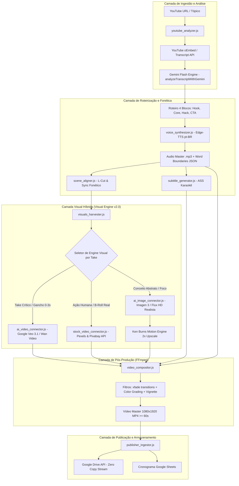

# Software Design Document (SDD) — Pipeline de Geração de Conteúdo IA v2.0
## AutoPublisher Pro: Da Extração de Vídeo à Monetização Multiplataforma

* **Projeto:** AutoPublisher Pro
* **Módulo:** Pipeline Autônoma de Geração de Conteúdo Dark e Vídeos Verticais (Upstream)
* **Versão:** 2.0.0
* **Status:** Aprovado para Implementação
* **Data:** 2026-09-11
* **Autor:** Engenheiro Staff / Arquiteto Backend
* **Documentos Relacionados:**
  * [`GEMINI.md`](../GEMINI.md) (Invariantes e Regras Mandatórias)
  * [`docs/DoD.md`](DoD.md) (Definition of Done)
  * [`docs/PRD_Pipeline_Automacao_Conteudo.md`](PRD_Pipeline_Automacao_Conteudo.md)
  * [`docs/backlog/epico-09-pipeline-geracao-conteudo-ia.md`](backlog/epico-09-pipeline-geracao-conteudo-ia.md)

---

## 1. Visão Geral e Objetivos do Sistema

### 1.1 Objetivo de Negócio
Desenvolver uma infraestrutura autônoma de produção de vídeos em formato vertical (9:16) com qualidade de transmissão cinematográfica, custo R$ 0,00 e alto índice de retenção, voltada para canais temáticos (canais dark) nos ecossistemas **YouTube Shorts**, **TikTok** (Creator Rewards Program, exigindo $\ge 60$s) e **Instagram Reels**.

O sistema recebe como entrada:
1. Uma **URL de vídeo do YouTube** (ex: palestras, audiolivros, podcasts, entrevistas); OU
2. Um **Tópico/Tema aberto** acompanhado de diretrizes de nicho.

E entrega como saída:
* Um vídeo vertical Full HD (1080x1920) $\ge 60$ segundos, renderizado com takes dinâmicos a cada 2 a 4 segundos (vídeos curtos gerados por IA, vídeos de estoque reais e imagens estáticas ultrarrealistas em movimento Ken Burns de 2x sem tremor).
* Legendas dinâmicas estilo karaokê sincronizadas foneticamente palavra a palavra com base nas fronteiras de áudio do sintetizador.
* Metadados completos de monetização (título com ganchos virais, descrição com tags e links de afiliados UTM, primeiro comentário fixado e thumbnail personalizada).
* Ingestão direta na fila de agendamento do AutoPublisher Pro para publicação com *scale-to-zero* no Google Cloud Run.

### 1.2 Premissas e Invariantes Arquiteturais
1. **Custo Operacional Zero (R$ 0,00):** Uso prioritário de camadas gratuitas (Edge-TTS, Gemini Flash API Free Tier, Pollinations AI, Pexels API Free Tier, Pixabay API).
2. **Resiliência Absoluta:** O pipeline nunca deve abortar por indisponibilidade de uma API externa. Cada elemento visual conta com uma cadeia de fallback de 4 níveis (IA Vídeo $\to$ Stock Vídeo Real $\to$ IA Imagem Fotorrealista $\to$ Asset Local/Procedural).
3. **Padrão de Qualidade Visual de Retenção:**
   * Sem cortes bruscos (*hard cuts* contínuos substituídos por *xfade* suave e intencional).
   * Movimento de câmera sem serrilhamento ou efeito "gelatina" (upscale de entrada de pelo menos 2x da resolução de saída antes do *zoompan*).
   * Correção de cor e textura unificada (color grading sutil, vinheta de foco e granulação leve de película).
4. **Conformidade de Monetização:** Duração $\ge 60.0$ segundos validados, `selfDeclaredMadeForKids: false`, hashtag `#Shorts` e parâmetros UTM intactos.

---

## 2. Arquitetura do Sistema e Fluxo de Dados

### 2.1 Diagrama de Arquitetura de Componentes



### 2.2 Fluxo Sequencial de Execução
1. **Entrada:** `run_pipeline.js` recebe parâmetros (`--url`, `--channel`, `--visual-mode`).
2. **Extração:** `youtube_analyzer.js` baixa metadados e transcrição oficial ou legendas geradas automaticamente.
3. **Síntese de Conteúdo:** O Gemini Flash analisa a transcrição completa, destila o insight central e gera o roteiro nos 4 blocos de alta retenção (145 a 165 palavras) com diretrizes visuais para cada frase.
4. **Síntese de Voz:** `voice_synthesizer.js` produz a locução via Edge-TTS e captura o array de fronteiras de palavras com precisão de milissegundos.
5. **Legendas Dinâmicas:** `subtitle_generator.js` gera o arquivo `.ass` com efeito karaokê animado no terço inferior da tela.
6. **Alinhamento Fonético:** `scene_aligner.js` correlaciona as frases visuais com os timestamps das palavras, inserindo L-Cuts cinematográficos de 100ms.
7. **Colheita Visual:** `visuals_harvester.js` adquire cada take conforme o tipo mais adequado:
   * *Take 1 (Hook):* Clipes de vídeo gerados por IA ou vídeos de alto impacto.
   * *Takes Intermediários:* Vídeos reais de estoque verticais (Pexels) ou imagens fotorrealistas animadas.
   * *Takes Abstratos:* Imagens geradas com prompts fotorrealistas (estilo documentário, lentes 35mm/50mm, sem CGI) + Ken Burns de alta resolução.
8. **Composição e Renderização:** `video_compositor.js` orquestra o FFmpeg aplicando transições suaves (`xfade`), vinheta escura de foco, gradação de cores e queima de legendas.
9. **Finalização:** Gera thumbnail de alta conversão e exporta manifesto de ingestão.

---

## 3. Especificação Detalhada dos Módulos

### 3.1 Módulo `youtube_analyzer.js` & `script_generator.js` (Motor de Inteligência)
* **Objetivo:** Substituir a análise baseada em regex por inteligência artificial contextual completa.
* **Nova Função:** `analyzeTranscriptWithGemini({ transcriptText, baseTitle, authorName, channelProfile, apiKey })`
  * Executa chamada via REST para `gemini-flash-lite-latest` ou `gemini-1.5-flash`.
  * **System Instruction:** Diretor criativo e roteirista sênior de canais dark de alta retenção.
  * **Estrutura Obrigatória da Resposta (JSON Schema):**
    ```json
    {
      "title": "Título magnético com menos de 65 caracteres #Shorts",
      "hook": "Frase de quebra de padrão de até 15 palavras (0-3s)",
      "scientific_core": "Mecanismo neurobiológico ou explicação lógica (3-45s)",
      "practical_hack": "Ação prática aplicável imediatamente (45-58s)",
      "cta": "Chamada para ação alinhada ao perfil do canal (58-65s)",
      "visual_scenes": [
        {
          "phrase": "Trecho exato falado correspondente a esta cena",
          "visual_intent": "Intenção dramática em português",
          "suggested_type": "ai_video | stock_video | ai_image",
          "stock_search_query": "Termos em inglês para busca no Pexels (ex: stressed businessman dark office)",
          "ai_prompt": "Prompt descritivo e fotorrealista em inglês para geração de imagem ou vídeo"
        }
      ]
    }
    ```
  * **Fallback Resiliente:** Se o Gemini retornar erro ou exceder o timeout de 8 segundos, o analisador recorre à função heurística já existente `extractConceptualSummary()`.

### 3.2 Novo Módulo `stock_video_connector.js` (B-Roll Real de Alta Qualidade)
* **Objetivo:** Fornecer videoclipes reais e cinematográficos em proporção 9:16 nativa sem custo de licenciamento.
* **Provedor Principal:** Pexels Video API (`https://api.pexels.com/videos/search`).
  * Parâmetros: `query`, `orientation=portrait`, `size=medium`, `per_page=5`.
  * Chave: `PEXELS_API_KEY` (gratuita: 200 req/hora, 20.000 req/mês).
* **Provedor Secundário:** Pixabay Video API (`https://pixabay.com/api/videos/`).
  * Parâmetros: `key`, `q`, `video_type=all`, `per_page=5`.
  * Chave: `PIXABAY_API_KEY` (gratuita: 100 req/minuto).
* **Processamento de Vídeo:**
  * O vídeo baixado é inspecionado e recortado para exatamente 1080x1920 (centralizado ou inteligente).
  * Aplicado ajuste de velocidade ou corte temporal (`-t ${durationSeconds}`) no FFmpeg.

### 3.3 Módulo `ai_video_connector.js` (Clipes Dinâmicos por IA)
* **Objetivo:** Gerar takes curtos e dinâmicos de 3 a 5 segundos com IA generativa.
* **Cadeia de Tentativas:**
  1. **Google Veo 3.1 Fast Preview** (`veo-3.1-fast-generate-preview` via Google AI Studio).
     * Modalidade preferida: *Image-to-Video* (anima a imagem de alta fidelidade gerada pelo Imagen 3 / Flux, conferindo consistência ao rosto/cenário).
     * Controle de cota: Caso retorne HTTP 429 ou erro de cota, desabilita Veo temporariamente para os takes seguintes do vídeo atual.
  2. **Pollinations Video Engine** (`model=wan` ou `model=cogvideo` em 720x1280 vertical).
     * Fallback rápido via HTTP stream.
  3. **Sinalizador para Ken Burns HD:** Caso nenhum motor de vídeo responda no tempo limite, direciona a cena para a renderização de imagem estática com movimento de câmera.

### 3.4 Módulo `ai_image_connector.js` & `ai_prompt_generator.js` (Fotorrealismo e Prompts)
* **Regras de Prompting Fotorrealista:**
  * Banimento rigoroso de termos que gerem plasticidade: `3D render`, `CGI`, `digital art`, `illustration`, `unreal engine`, `smooth skin`.
  * Injeção de especificações físicas e fotográficas reais: `shot on 35mm film`, `authentic human skin texture with pores and micro-details`, `kodak portra 400 grain`, `natural dramatic rim lighting`, `documentary photograph`, `candid angle`.
  * Prompt Negativo Universal: Aplicado em todas as chamadas do Pollinations Flux para filtrar estética artificial.

### 3.5 Módulo `visuals_harvester.js` (Motion Engine Ken Burns 2x)
* **Resolução do Jitter de Movimento:**
  * As imagens de entrada (1080x1920) são primeiramente redimensionadas para resolução 2x: **2160x3840** usando filtro `bicubic`.
  * O filtro `zoompan` opera sobre a matriz de 2160x3840 com amostragem de ponto flutuante, e ao final redimensiona para 1080x1920 a 30fps.
  * O resultado elimina qualquer trepidação (*stutter/jitter*) perceptível em telas de alta densidade (OLED/Retina).

### 3.6 Módulo `video_compositor.js` (Pós-Produção Cinematográfica)
* **Transições Suaves (`xfade`):**
  * Para vídeos compostos por $N$ takes, o FFmpeg utiliza o filtro `xfade` conectando take $i$ e take $i+1$ com transição de 0.25 a 0.3 segundos (efeitos: `fade`, `dissolve`, `fadeblack`).
  * O take 0 (Gancho de retenção) mantém corte seco para prender o espectador imediatamente.
* **Color Grading e Vinheta Unificada:**
  * Criação de ambiente imersivo através de cadeia de filtros:
    ```
    [v_scenes]vignette=angle=PI/5:mode=forward,curves=vintage,noise=alls=5:allf=t[graded]
    ```
* **Áudio Broadcast e Normalização:**
  * O áudio do locutor é processado com `loudnorm=I=-14:TP=-1:LRA=11` (padrão oficial de entrega para YouTube Shorts e TikTok).
  * Trilha de fundo com *ducking* dinâmico a 12% durante a locução e fade-out elegante de 2.0 segundos antes do término.

---

## 4. Contratos de Dados e Estruturas de Comunicação

### 4.1 Contrato da Cena Visual (`SceneObject`)
```typescript
interface SceneVisualTrack {
  id: number;                     // Índice sequencial da cena (1..N)
  phrase: string;                 // Frase falada sincronizada
  duration: number;               // Duração exata em segundos (ex: 3.4)
  startTime: number;              // Timestamp de início relativo (ex: 12.3)
  endTime: number;                // Timestamp de término relativo (ex: 15.7)
  motionType: 'push_in' | 'reveal_zoom_out' | 'pan_left_right' | 'pan_right_left' | 'atmospheric_drift';
  visualType: 'ai_video' | 'stock_video' | 'ai_image';
  stockQuery?: string;            // Consulta de busca para Pexels/Pixabay
  prompt: string;                 // Prompt em inglês completo para Imagen/Flux
  visualDescription: string;      // Descrição em português para logs e manifesto
  assetPath?: string;             // Caminho local do clipe renderizado (.mp4)
}
```

### 4.2 Contrato do Roteiro Completo (`AdaptedScript`)
```typescript
interface AdaptedScript {
  source: 'youtube' | 'catalog' | 'topic';
  sourceUrl?: string;
  topic: string;
  title: string;                  // Título magnético < 100 caracteres com #Shorts
  narrationText: string;          // Texto corrido unificado dos 4 blocos
  wordCount: number;              // Total de palavras (145 a 165)
  estimatedDurationSeconds: number; // Duração prevista (60 a 70 segundos)
  rewardsEligible: boolean;       // true se duração >= 60s
  blocks: [
    { title: 'Gancho (0-3s)', text: string, visualDescription: string },
    { title: 'Foco Central (3-45s)', text: string, visualDescription: string },
    { title: 'Hack Prático (45-58s)', text: string, visualDescription: string },
    { title: 'CTA & Retenção (58-65s)', text: string, visualDescription: string }
  ];
  metadata: {
    title: string;
    description: string;
    tags: string;
    categoryId: number;
    madeForKids: boolean;
    privacy: 'PUBLIC' | 'UNLISTED' | 'PRIVATE';
    firstComment: string;
  };
  scenes: SceneVisualTrack[];
}
```

---

## 5. Matriz de Resiliência e Estratégia de Fallback

| Recurso | Nível 1 (Primário) | Nível 2 (Fallback I) | Nível 3 (Fallback II) | Nível 4 (Contingência Total) |
|---|---|---|---|---|
| **Roteirização** | Gemini Flash API (via transcript) | Gemini Flash (via título + meta) | Heurística `extractConceptualSummary` | Script do Catálogo Local |
| **Clipes de Vídeo** | Google Veo 3.1 Image-to-Video | Pexels Stock Video 9:16 | Pixabay Stock Video 9:16 | Ken Burns Motion sobre Imagem IA |
| **Imagens de Cena** | Google Imagen 3 (1080x1920) | Pollinations AI Flux HD | Pollinations AI Turbo | Imagens do Canal (`assets/scenes/`) |
| **Locução Neural** | Edge-TTS `pt-BR-AntonioNeural` | Edge-TTS `pt-BR-FranciscaNeural` | Síntese Local Alternativa | Procedural com BGM |
| **Trilha Sonora** | Trilha do Perfil do Canal | Trilha Padrão do Repositório | Biblioteca de Áudio Livre | Sem música (apenas locução) |

---

## 6. Plano de Implementação e Roteiro de Tarefas

A implementação seguirá uma sequência de engenharia sem quebra de testes existentes:

### Passo 1: Polimento Imediato do Motor de Vídeo e Movimento (FFmpeg)
* Modificar [`pipeline/src/visuals_harvester.js`](file:///D:/estudo/Projetos/AutoPublisher/pipeline/src/visuals_harvester.js): Elevar a resolução intermediária do Ken Burns de 1240x2204 para 2160x3840, com interpolação bicúbica.
* Modificar [`pipeline/src/video_compositor.js`](file:///D:/estudo/Projetos/AutoPublisher/pipeline/src/video_compositor.js): Implementar suporte a transições `xfade` e filtro de gradação de cor / vinheta.

### Passo 2: Implementação do Conector de Vídeos de Estoque Reais (B-Roll)
* Criar `pipeline/src/stock_video_connector.js`: Suporte a busca, download e formatação 9:16 via Pexels e Pixabay.
* Integrar `stock_video_connector.js` em `visuals_harvester.js`.

### Passo 3: Implementação da Roteirização Contextual com Gemini Flash
* Expandir [`pipeline/src/youtube_analyzer.js`](file:///D:/estudo/Projetos/AutoPublisher/pipeline/src/youtube_analyzer.js): Implementar `analyzeTranscriptWithGemini()` para transformar transcripts em roteiros ricos e cenas contextualizadas com diretrizes visuais precisas.
* Atualizar [`pipeline/src/script_generator.js`](file:///D:/estudo/Projetos/AutoPublisher/pipeline/src/script_generator.js) para permitir geração de roteiros a partir de temas livres usando o Gemini.

### Passo 4: Refinamento de Prompts e Image-to-Video com Veo
* Atualizar [`pipeline/src/ai_video_connector.js`](file:///D:/estudo/Projetos/AutoPublisher/pipeline/src/ai_video_connector.js): Implementar fluxo Image-to-Video (gerar imagem estática de alta fidelidade e animá-la pelo Veo para consistência).
* Afinar parâmetros de prompts negativos e vocabulário documental em [`pipeline/src/ai_prompt_generator.js`](file:///D:/estudo/Projetos/AutoPublisher/pipeline/src/ai_prompt_generator.js).

### Passo 5: Verificação de Ponta a Ponta e Validação de Qualidade
* Executar bateria de testes com o vídeo de teste do YouTube (`https://www.youtube.com/watch?v=jr796x0sFfg`).
* Validar: resolução 1080x1920, ausência de jitter, sincronismo fonético, duração $\ge 60$s, integridade de metadados.
