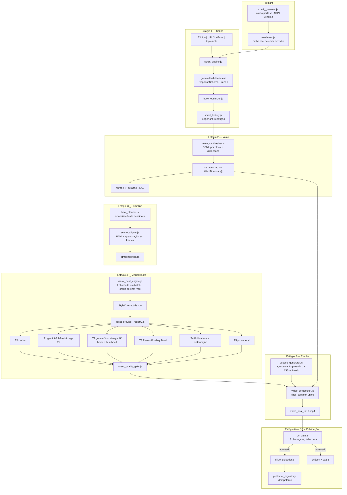

# Software Design Document (SDD) — Pipeline de Conteúdo IA v3.0
## AutoPublisher Pro: Arquitetura de Estágios Tipados com Gate de Qualidade

* **Projeto:** AutoPublisher Pro
* **Módulo:** Pipeline Autônoma de Geração de Vídeos Verticais (Upstream)
* **Versão:** 3.0.0
* **Status:** Proposto para Implementação
* **Data:** 2026-09-15
* **Supersede:** [SDD v2.0](SDD_Pipeline_Conteudo_IA_v2.md)
* **Documentos Relacionados:**
  * [`docs/Plano_Refatoracao_Qualidade_Pipeline.md`](Plano_Refatoracao_Qualidade_Pipeline.md) (diagnóstico, fases e critérios de aceite)
  * [`docs/adr/0006-fonte-de-visuais-e-teto-de-qualidade.md`](adr/0006-fonte-de-visuais-e-teto-de-qualidade.md)
  * [`GEMINI.md`](../GEMINI.md) (invariantes e regras mandatórias)
  * [`docs/DoD.md`](DoD.md)

---

## 1. Por Que Uma v3

A v2 especificou corretamente o **produto** (vídeo 9:16, cortes de 2–4s, legendas karaokê, 4 tiers de fallback) mas não especificou os **contratos** entre estágios nem nenhum mecanismo de verificação. O resultado, medido em produção, é que três dos quatro tiers prometidos estão mortos e nenhum deles falha de forma visível.

A v3 mantém o produto da v2 e muda a arquitetura em três eixos:

1. **Estágios tipados com contrato explícito.** Cada estágio recebe e devolve uma estrutura validada. Um estágio não "degrada silenciosamente": ou entrega o contrato, ou declara `degraded: true` com motivo.
2. **Verificação em todo limite de confiança.** Todo asset externo é validado por decodificação real (dimensão, luminância, aspecto), nunca por status HTTP ou tamanho de buffer. Todo artefato local é medido com `ffprobe`, nunca estimado.
3. **Configuração como contrato.** O perfil do canal é validado contra JSON Schema com `additionalProperties: false`. Uma chave declarada sem consumidor é erro de boot, não degradação em runtime.

### 1.1 Invariantes Arquiteturais (revisados)

| # | Invariante | Mudança em relação à v2 |
|---|---|---|
| I-1 | **Custo operacional controlado**, não necessariamente zero | A v2 afirmava R$ 0,00 como invariante. Está provado que o teto gratuito de imagem é 0,59 MP com marca d'água. O custo passa a ser uma **decisão explícita** com teto por run, não uma premissa. |
| I-2 | **Resiliência com degradação declarada** | A v2 exigia "nunca abortar". A v3 exige que toda degradação seja **registrada, medida e visível**, e que o QC gate possa recusar a publicação. |
| I-3 | **Nenhum pixel sem procedência verificada** | Novo. Todo asset carrega `{provider, model, width, height, grade}` e só entra na timeline se `grade.ok`. |
| I-4 | **Nenhuma duração estimada** | Novo. Toda duração vem de `ffprobe`. Estimativas só existem no planejamento, nunca na timeline. |
| I-5 | **Conformidade de monetização verificada** | A v2 declarava `rewardsEligible` a partir de estimativa. A v3 mede o MP4 final. |
| I-6 | **Ineditismo obrigatório** | Novo. Nenhum roteiro cujo `sha1(narrationText)` já exista para o canal pode ser publicado. |

---

## 2. Arquitetura Alvo

### 2.1 Diagrama de estágios



### 2.2 Módulos: novos, reescritos, removidos

| Ação | Caminho | Responsabilidade |
|---|---|---|
| **novo** | `pipeline/src/config_resolver.js` | Carrega e valida o perfil do canal contra `channel.schema.json`; retorna objeto achatado e congelado. Fail-fast. |
| **novo** | `pipeline/config/channel.schema.json` | JSON Schema draft 2020-12, `additionalProperties: false` em cada bloco. |
| **novo** | `pipeline/src/readiness.js` | Probes reais por provider antes de produzir. Loga WARN por tier desabilitado. |
| **novo** | `pipeline/src/stage_runner.js` | Executor declarativo de estágios: try/catch, retry por natureza, timing, persistência de `run.json`, `--resume`. |
| **novo** | `pipeline/src/script_engine.js` | Geração de roteiro via LLM com `responseSchema`, repair e validação semântica. Absorve o caminho de tópico livre. |
| **novo** | `pipeline/src/hook_optimizer.js` | Passe isolado de reescrita do gancho. |
| **novo** | `pipeline/src/script_history.js` | Ledger de ineditismo por canal (`pipeline/state/script_history.json`). |
| **novo** | `pipeline/src/beat_planner.js` | Reconciliação de densidade de cortes: subdivisão e fusão de beats. |
| **novo** | `pipeline/src/visual_beat_engine.js` | Uma chamada em batch → `VisualBeat[]` validados, com grade de `shotType` e `StyleContract`. |
| **novo** | `pipeline/src/asset_provider_registry.js` | Registry de providers com capabilities declaradas, circuit breaker e roteamento. |
| **novo** | `pipeline/src/asset_quality_gate.js` | Aprovação/reprovação de asset individual. |
| **novo** | `pipeline/src/asset_cache.js` | Cache content-addressed com sidecar de qualidade e negative-cache. |
| **novo** | `pipeline/src/qc_gate.js` | 13 checagens sobre o MP4 final. |
| **novo** | `pipeline/src/drive_uploader.js` | Upload resumable para as pastas de `publishing_profile`. |
| **novo** | `pipeline/src/ffmpeg_env.js` | Resolução de binários por `FFMPEG_PATH`/`FFPROBE_PATH` com import dinâmico do installer em try/catch. |
| **novo** | `pipeline/src/obs.js` | Log estruturado NDJSON + coletor de métricas e custo. |
| **novo** | `pipeline/src/cli.js` | Subcomandos `run`, `preview`, `qc`, `readiness` com saída `--json`. Contrato único com o Java. |
| **reescrito** | `pipeline/src/subtitle_generator.js` | Agrupamento prosódico, 1 `Dialogue` por card, animação, config do canal. |
| **reescrito** | `pipeline/src/scene_aligner.js` | Restrições min/max, projeção PAVA, threshold normalizado, quantização em frames. |
| **reescrito** | `pipeline/src/ai_image_connector.js` | Vira cliente fino dos providers do registry. Perde a cascata embutida. |
| **refatorado** | `pipeline/src/run_pipeline.js` | Vira um orquestrador magro sobre `stage_runner.js`. |
| **refatorado** | `pipeline/src/video_compositor.js` | `filter_complex` único, CRF, cadeia de áudio, `ffprobe` no `on('end')`. |
| **refatorado** | `pipeline/src/voice_synthesizer.js` | SSML por bloco, `xmlEscape`, parser de metadata com buffer incremental, duração por `ffprobe`. |
| **refatorado** | `pipeline/src/stock_video_connector.js` | Ranking, filtro de orientação, dedup, captura de licença. |
| **refatorado** | `pipeline/src/publisher_ingestor.js` | Idempotência, retry, `success:false` real, `driveVideoId` obrigatório. |
| **removido** | `generateImageWithImagen3` (em `ai_image_connector.js`) | Modelo inexistente para a chave (404). |
| **removido** | `generateVideoWithPollinations` (em `ai_video_connector.js`) | Endpoint não existe; grava JPEG como `.mp4`. |
| **removido** | Bancos `ghibliScenes`/`animeScenes`/`stoicScenes`/`cyberScenes`/`photoScenes` | Substituídos pelo `VisualBeat` do LLM; resta apenas um banco de emergência. |
| **removido** | Catálogo hardcoded em `AiPipelineService.previewScript` (Java) | Fonte de verdade dupla, já divergente do Node. |

---

## 3. Contratos de Dados

Todos os contratos são validados na fronteira do estágio. Um estágio que não consegue produzir seu contrato falha de forma explícita.

### 3.1 `ChannelConfig` (saída do `config_resolver`)

Validado contra `pipeline/config/channel.schema.json`. Blocos obrigatórios: `format`, `script_profile`, `voice_profile`, `visual_profile`, `audio_profile`, `publishing_profile`. `additionalProperties: false` em cada um — **uma chave com typo falha no boot**.

Campos que passam a ter consumidor obrigatório (hoje todos mortos):

```
format.target_fps ................. video_compositor (-r), scene_aligner (quantização)
format.resolution ................. video_compositor (-s), asset_quality_gate (mínimo)
format.cuts_interval_seconds ...... beat_planner (densidade), qc_gate (QC-11)
format.target_duration_seconds .... qc_gate (QC-1)
script_profile.* .................. script_engine (prompt), qc_gate (contagem de palavras)
voice_profile.pitch / .volume ..... voice_synthesizer
visual_profile.subtitles_style .... subtitle_generator
visual_profile.prompt_prefix ...... visual_beat_engine
visual_profile.lighting ........... visual_beat_engine
audio_profile.* ................... video_compositor (mix, ducking, loudnorm)
publishing_profile.platforms ...... publisher_ingestor (um post por plataforma)
publishing_profile.drive_folder_* . drive_uploader
```

### 3.2 `Script`

```jsonc
{
  "scriptId": "string",
  "generator": "gemini | heuristic | catalog | template",  // proveniência obrigatória
  "degraded": false,
  "channelId": "string",
  "topic": "string",
  "title": "string",                    // <= 65 chars, com lacuna de curiosidade
  "narrationText": "string",
  "narrationHash": "sha1",              // chave do ledger de ineditismo
  "wordCount": 0,
  "estimatedDurationSeconds": 0.0,      // planejamento; NUNCA usado na timeline
  "blocks": [                           // campos de primeira classe, nunca re-fatiados
    { "id": "hook",  "text": "...", "ssmlRate": "+12%", "pauseAfterMs": 220 },
    { "id": "core",  "text": "...", "ssmlRate": "+4%",  "pauseAfterMs": 180 },
    { "id": "hack",  "text": "...", "ssmlRate": "-6%",  "pauseAfterMs": 200 },
    { "id": "cta",   "text": "...", "ssmlRate": "+0%",  "pauseAfterMs": 600 }
  ],
  "metadata": { "title": "...", "description": "...", "tags": [], "categoryId": 28,
                "madeForKids": false, "privacy": "PUBLIC", "firstComment": "..." }
}
```

### 3.3 `VoiceResult`

```jsonc
{
  "audioPath": "string",
  "durationSecondsMeasured": 62.41,   // ffprobe — fonte de verdade da timeline
  "lastWordEndMs": 61980,             // âncora para o aligner, campo SEPARADO
  "wordBoundaries": [ { "word": "...", "startMs": 0, "endMs": 0, "durationMs": 0 } ],
  "voice": "pt-BR-AntonioNeural", "rate": "-4%", "pitch": "-2Hz",
  "ssmlUsed": true
}
```

### 3.4 `VisualBeat`

Substitui o objeto de cena livre da v2. É o contrato que elimina o descompasso tema↔imagem e a monotonia.

```jsonc
{
  "id": 1,
  "phrase": "trecho falado correspondente",
  "blockType": "hook | body | hack | cta",
  "shotType": "extreme_closeup | macro_object | medium_two_shot | wide_establishing | over_shoulder | low_angle_hero | top_down | silhouette_backlit",
  "subject": "sintagma nominal concreto em inglês",
  "action": "verbo + complemento",
  "environment": "local e contexto",
  "lighting": "esquema de luz",
  "negativePrompt": "string",
  "suggestedType": "ai_image | stock_video",
  "stockQuery": "2-4 palavras em inglês",
  "motionType": "push_in | pan_left_right | reveal_zoom_out | pan_right_left | atmospheric_drift",
  "cinemagraphFX": "fire_embers | fireflies | twinkling_stars | sunbeams_dust | anime_aura_sparks | none"
}
```

**Regras de validação** (aplicadas antes de gerar qualquer imagem):
- `shotType` distinto entre beats adjacentes;
- similaridade de trigramas (Dice) entre `subject + environment` de quaisquer dois beats no máximo 0,45 — beats colididos são reprompted, não aceitos;
- `subject` não pode ser vazio nem genérico (lista de bloqueio: `"person"`, `"scene"`, `"concept"`).

### 3.5 `StyleContract` (por run)

```jsonc
{
  "runSeed": 812734,                  // derivado de hash(scriptId) — determinístico
  "styleToken": "ghibli-gouache-v1",
  "palette": ["#2E4A32", "#D9B26A", "#1B2430"],
  "characterSheet": "a 30-year-old knight, short auburn beard, dented steel sallet helm, faded azure wool cloak",
  "lensFamily": "85mm f/1.4 prime"
}
```

Persistido no manifesto da run. É o que dá identidade visual consistente **sem** repetir composição.

### 3.6 `TimelineScene`

```jsonc
{
  "beatId": 1,
  "startFrame": 0, "endFrame": 68,     // frames são a fonte de verdade
  "startMs": 0,    "endMs": 2266,      // derivados: frame / fps * 1000
  "durationMs": 2266,
  "alignmentType": "word_boundary_phrase_match | speech_pause_snap | proportional_fallback",
  "matchConfidence": 0.83,             // normalizado 0..1
  "assetPath": "string",
  "assetGrade": { "ok": true, "score": 0.91, "width": 1536, "height": 2730, "reasons": [] },
  "provider": "gemini-3.1-flash-image",
  "status": "pending | generated | graded | rendered | failed"
}
```

### 3.7 `RunManifest` (`${outputDir}/run.json`)

Escrito após **cada** estágio. Habilita `--resume` e auditoria post-mortem.

```jsonc
{
  "runId": "run_...", "startedAt": "...", "options": {}, "resolvedConfig": {},
  "styleContract": {}, "script": {}, "timeline": [],
  "stages": [ { "id": "script", "status": "ok", "durationMs": 4120, "artifacts": [], "error": null } ],
  "providerCalls": [ { "provider": "...", "attempts": 1, "httpStatus": 200, "latencyMs": 3100, "bytes": 812344, "costUsd": 0.03 } ],
  "qc": {}, "totalCostUsd": 0.27
}
```

---

## 4. Especificação dos Módulos

### 4.1 `readiness.js` — Production Readiness Gate

Roda antes de qualquer produção. Valida **existência e dimensão**, não status HTTP.

- Texto: `gemini-flash-lite-latest` deve responder a um prompt trivial com `finishReason === 'STOP'`.
- Imagem: `resolveAvailableImageModel()` consulta `models.list` e retorna o primeiro id da preferência que **realmente exista**; `null` significa "pular o tier Google inteiro". Isso teria detectado o 404 de `imagen-3.0-generate-002` antes da primeira run.
- Stock: `PEXELS_API_KEY`/`PIXABAY_API_KEY` presentes e respondendo a uma busca de teste.
- Local: binários de `ffmpeg_env.js` resolvem; fonte de `subtitles_style` resolve via `fc-match` **sem fallback**.

Todo tier desabilitado emite WARN nomeando a credencial ausente. Degradação silenciosa deixa de existir.

### 4.2 `asset_provider_registry.js` — Cascata ordenada por custo/qualidade

| Tier | Provider | Custo | Uso |
|---|---|---|---|
| T0 | Cache local (`asset_cache.js`) | US$ 0 / ~5ms | Sempre consultado primeiro. Hit só é aceito se `grade.ok === true`. |
| T1 | `gemini-3.1-flash-image` `:generateContent`, `imageSize:'2K'` | ~US$ 0,03/img | Corpo (beats 2..n−1) |
| T2 | `gemini-3-pro-image` `:generateContent`, `imageSize:'4K'` | ~US$ 0,13/img | Gancho (beat 1) + thumbnail |
| T3 | Pexels → Pixabay B-roll | US$ 0 | `suggestedType === 'stock_video'` (ação humana concreta) |
| T4 | Pollinations + restauração | US$ 0 | Último recurso remoto |
| T5 | `createProceduralDarkScene` | US$ 0 | Rede indisponível |

Chamada de imagem do Gemini — chave **sempre em header**, nunca em `?key=` na URL:

```js
POST https://generativelanguage.googleapis.com/v1beta/models/${model}:generateContent
headers: { 'x-goog-api-key': apiKey, 'Content-Type': 'application/json' }
body: {
  contents: [{ role: 'user', parts: [{ text: prompt }] }],
  generationConfig: {
    responseModalities: ['IMAGE'],
    imageConfig: { aspectRatio: '9:16', imageSize: '2K' }   // '1K' | '2K' | '4K'
  }
}
```

**Circuit breaker por modelo**, substituindo `imagenDisabledForSession` e `isVeoDisabledForSession`:

| Erro | Ação |
|---|---|
| 404 | Abre permanentemente **na run** (modelo não existe) |
| 429 com `quotaId` contendo `PerMinute` | Abre por 60s |
| 429 com `quotaId` contendo `PerDay` | Abre por 6h |
| 400 | **Nunca** abre o breaker (erro de payload, não de disponibilidade) |
| 5xx | Backoff exponencial com jitter, 3 tentativas |

### 4.3 `asset_quality_gate.js`

```
MIN_W = 864, MIN_H = 1536
aspecto: |w/h − 9/16| <= 0,06
luminância média: [38, 215]
desvio-padrão de cor: acima do piso (rejeita placeholder chapado)
bytes mínimos: w * h * 0,02 (rejeita JPEG de erro)
magic bytes: JPEG (FF D8 FF) ou PNG (89 50 4E 47)
watermark: energia de borda do quadrante inferior-direito ÷ espelho esquerdo < 2,2
```

Asset reprovado **cai para o próximo tier**. Nunca é aceito com aviso.

### 4.4 `visual_beat_engine.js`

Uma única chamada recebe **todas** as frases e devolve **todos** os beats, com `responseSchema` declarado. Isso é o que torna a não-repetição possível: o modelo vê o conjunto.

Diversidade é imposta **por construção**, não por instrução:
1. Grade obrigatória de 8 `shotType` rotacionados, passada no prompt;
2. Validação por similaridade de trigramas rejeitando colisões;
3. Reprompt **apenas** dos beats colididos, com a lista dos já aceitos no contexto.

Montagem do prompt final por camadas com orçamento — nunca truncamento por caractere. Ordem de descarte quando o destino exige prompt curto: `environment_detail` → `lens` → `grading` → `style` → `action`. **Nunca** descartar `subject`, `style` base ou o sufixo de controle (`vertical 9:16, no text, no watermark`), que é reanexado **após** o corte.

### 4.5 `beat_planner.js` — Densidade de cortes

```
[minCut, maxCut] = config.format.cuts_interval_seconds           // default [2.0, 4.0]
targetSceneCount = round(durationSecondsMeasured / ((minCut+maxCut)/2))
```

Para 62,6s com [2,4] → **21 cenas** (hoje: 8).

- `beats.length < target` → **subdividir** nos limites de vírgula/conjunção/pausa >150ms do próprio `wordBoundary`. Um mesmo beat gera 2–3 sub-takes da **mesma imagem** com `motionType` e crop diferentes — sem custo adicional de geração.
- `beats.length > target` → **fundir** beats adjacentes.

### 4.6 `scene_aligner.js` (reescrito)

Correções sobre a implementação atual:

1. **Threshold normalizado.** `maxPossibleScore = 2.0 + 1.5*(nTokens−1)`; aceitar apenas `score >= 0.62 * maxPossibleScore`. Para 6 tokens isso exige a primeira palavra mais duas subsequentes. Hoje casar **só** a primeira palavra (2,0 ≥ 1,5) aprova.
2. **Stopwords não ancoram.** Se `searchTokens[0].length <= 2`, deslocar a janela para a primeira palavra de conteúdo (≥4 chars).
3. **Cursor consome o span.** `boundaryCursor = matchIndex + max(1, nTokens − 2)`, evitando que a próxima cena case dentro da frase anterior.
4. **Janela derivada.** `lookahead = max(8, ceil(targetSceneSeconds * wordsPerSecond * 1.8))` em vez do `90` fixo.
5. **Pause-snap com custo composto** em janela local de `±min(1200ms, 0.35 * duraçãoAlvo)`:
   `score = pauseMs/300 − |mid − target|/janela * 2 + (pontuaçãoForte ? 1.5 : 0)`.
   Corrige o `else if (maxPause < 200)` que hoje fica permanentemente desligado.
6. **Teto de duração.** `minSceneMs = 1800`, `maxSceneMs = 4500`, com projeção do vetor de cortes na região viável por varredura para frente e para trás até convergir.
7. **Quantização em frames.** `cutFrames[i] = round(cutMs[i]/1000*fps)`; `cutMs` é derivado de volta. Elimina o drift cumulativo de −36,7ms medido.

### 4.7 `subtitle_generator.js` (reescrito)

**Agrupamento prosódico em 2 passes.** Passe 1: `gap[i] = wb[i+1].startMs − wb[i].endMs`; fronteira forte em `gap >= 260ms`, fraca em `gap >= 110ms`. Passe 2: alinhar ao `narrationText` normalizado e promover a forte todo token seguido de `[.?!]`, a fraca todo token seguido de `[,;:]`.

Empacotamento de cards por prioridade: (a) nunca cruzar fronteira forte; (b) no máximo 2 linhas; (c) duração entre 700 e 2200ms.

**Um `Dialogue` por card**, com sweep de cor por palavra via `\t` (tempos relativos ao início do evento, em ms) — reduz de 160 eventos/26,6KB para cerca de 40.

**Ênfase sem reflow.** `\fscx`/`\fscy` inline estão proibidos: alteram o avanço do glifo e movem o bloco inteiro. Ênfase por `\c`, `\bord` e `\blur`, que expandem apenas o bitmap.

**Animação de entrada** (uma vez por card, durante o fade-in, onde o reflow é lido como intenção):
```
{\fad(70,90)\t(0,110,\fscx103\fscy103)\t(110,200,\fscx100\fscy100)}
```

**Layout.** `WrapStyle: 2` (nenhuma quebra automática) com `\N` calculado por largura medida. `PlayResX/Y` derivados de `format.resolution`.

**Safe area.** União das zonas de UI para PlayResY=1920: Shorts 320, Reels 360, TikTok 470 → `marginV = 560`. O mesmo MP4 vai para as três plataformas.

**Escape obrigatório** de `\`, `{`, `}` em todo texto interpolado — hoje texto entre chaves é silenciosamente engolido pelo libass.

Todo o estilo vem de `visual_profile.subtitles_style`, com **fail-fast** se um campo declarado estiver ausente.

### 4.8 `voice_synthesizer.js` (refatorado)

- **`xmlEscape` obrigatório.** `msedge-tts` interpola o texto direto no template SSML sem escape: um `&` no roteiro aborta a síntese inteira.
- **SSML por bloco** via `rawToStream`, com `rate` derivado de `Script.blocks[].ssmlRate` e `<break>` de `pauseAfterMs`. Alvo: LRA de pelo menos 5 LU (atual: 2,5).
- **Parser de metadata com buffer incremental.** O parser atual só aceita linhas que começam com `{` e terminam com `}`; JSON dividido entre chunks é descartado em silêncio.
- **Duração por `ffprobe`**, com `lastWordEndMs` mantido como campo separado.
- **Bitrate da fonte** em 96–192 kbps (hoje 48 kbps mono).

### 4.9 `video_compositor.js` (refatorado)

**Vídeo — passagem única.** Elimina o reencode duplo (clipe → concat → final). Hard cut é o default (correto para o formato); `xfade` apenas em mudança de ato, com `duration=0.18–0.25`. `fade=t=in` só no primeiro clipe, `fade=t=out` só no último — **nunca** fade nas fronteiras internas, que hoje produzem 300ms de tela escurecendo.

Motion sem upscale destrutivo:
```
scale=1080:1920:flags=lanczos:force_original_aspect_ratio=increase,crop=1080:1920,
unsharp=5:5:0.9:5:5:0.0,setsar=1,
zoompan=z='min(1.16,1.03+(0.13*on/(30*DUR)))':x='iw/2-(iw/zoom/2)':y='ih/2-(ih/zoom/2)':s=1080x1920:fps=30
```
Quando houver necessidade de matriz para pan, no máximo 1,5x (1620x2880) com `flags=lanczos+accurate_rnd` — nunca 3,75x.

**Áudio — ordem correta das operações.** O erro atual é normalizar a voz **antes** do mix e depois usar `amix` cru, que derruba 6 dB (medido: −14,5 → −20,5 LUFS).
```
[voice]highpass=f=80,acompressor=threshold=0.05:ratio=3:attack=10:release=180,asplit=2[voz][key];
[music]volume=${bg_music_volume},afade=t=out:st=${dur-fade_out_seconds}:d=${fade_out_seconds}[bg];
[bg][key]sidechaincompress=threshold=0.03:ratio=8:attack=5:release=250[bgduck];
[voz][bgduck]amix=inputs=2:duration=first:normalize=0:dropout_transition=0[premix];
[premix]alimiter=limit=-1.0dB:attack=5:release=50,aresample=48000[aout]
```
`loudnorm` **two-pass** aplicado apenas à soma final, com alvo `audio_profile.target_lufs`.

**Encode.** `-crf 20 -preset slow -profile:v high -level 4.1 -pix_fmt yuv420p`, colorspace `bt709`, `-movflags +faststart`. Substitui `-b:v 4500k` CBR, que hoje gasta bitrate em borrão interpolado.

**`ffprobe` no `on('end')`**, retornando duração **medida**.

### 4.10 `qc_gate.js`

13 checagens com falha dura, especificadas em [Plano §6](Plano_Refatoracao_Qualidade_Pipeline.md#6-gate-de-qualidade-qc). Relatório em `${outputDir}/qc.json`. Reprovação retorna exit code 3 e **não** chama a ingestão.

Limiar de referência para QC-7 (nitidez): a linha de base medida do render atual é **1,20**; o alvo é **2,5**. Um asset nativo do repositório mede 5,04.

### 4.11 `stage_runner.js`

```js
const STAGES = [
  { id: 'preflight', run: ctx => ..., required: true,  retry: 'none'    },
  { id: 'script',    run: ctx => ..., required: true,  retry: 'network' },
  { id: 'voice',     run: ctx => ..., required: true,  retry: 'network' },
  { id: 'timeline',  run: ctx => ..., required: true,  retry: 'none'    },
  { id: 'visuals',   run: ctx => ..., required: true,  retry: 'per-item'},
  { id: 'subtitles', run: ctx => ..., required: true,  retry: 'none'    },
  { id: 'render',    run: ctx => ..., required: true,  retry: 'once'    },
  { id: 'qc',        run: ctx => ..., required: true,  retry: 'none'    },
  { id: 'upload',    run: ctx => ..., required: false, retry: 'network' },
  { id: 'ingest',    run: ctx => ..., required: false, retry: 'network' },
]
```

Cada estágio grava `run.json` ao terminar. `--resume <runId>` retoma do primeiro estágio não-`ok`. O loop de `--batch` captura por item e continua, agregando sucessos e falhas em relatório final.

### 4.12 `obs.js` — Observabilidade

Eventos NDJSON em canal dedicado, com a prosa humana preservada em stderr durante a transição:

```
@@EVT {"ts":"...","runId":"...","level":"info","stage":"visuals","event":"stage_end","durationMs":48210,"data":{...}}
```

`AiPipelineService` (Java) passa a parsear **apenas** linhas com o prefixo `@@EVT`. Hoje o contrato de integração é prosa em português — daí a ordem obrigatória: F8.3 antes de F8.7.

Redação de segredos em toda mensagem persistida deve cobrir o formato real da chave do projeto:
```js
.replace(/AQ\.[A-Za-z0-9_-]{20,}/g, '[redacted]')   // formato desta chave
.replace(/AIza[A-Za-z0-9_-]+/g,     '[redacted]')
```

---

## 5. Matriz de Resiliência (revisada)

A matriz da v2 listava 4 tiers; três estavam mortos. A v3 exige que a matriz seja **verificada em runtime** pelo `readiness.js`.

| Elemento | T1 | T2 | T3 | T4 | Verificação |
|---|---|---|---|---|---|
| Roteiro | `gemini-flash-lite-latest` | heurística extrativa sobre a transcrição | catálogo (com ledger de ineditismo) | template (`degraded:true`) | `finishReason === 'STOP'` + schema |
| Imagem | `gemini-3.1-flash-image` 2K | `gemini-3-pro-image` 4K (hook/thumb) | Pollinations + restauração | procedural | `asset_quality_gate` |
| B-roll | Pexels | Pixabay | — | cai para imagem | dimensão + orientação + licença |
| Vídeo IA | `veo-3.1-fast` | — | — | cai para imagem + motion | magic bytes `ftyp` + `ffprobe` |
| Voz | Edge-TTS | — | — | falha dura | `ffprobe` + RMS |
| Trilha | `audio_profile.bg_music_track` | primeiro arquivo do canal | global | sem trilha | existência + duração |

---

## 6. Plano de Implementação

Ordem, esforço e critérios de aceite estão em [Plano §5](Plano_Refatoracao_Qualidade_Pipeline.md#5-plano-de-execução). Resumo de sequenciamento e dependências:

| Fase | Depende de | Bloqueia | Observação |
|---|---|---|---|
| F0 | — | nada | Correções de 1–5 linhas. Pode ir para produção isoladamente. |
| F1 | DECISÃO 1 | F5 (parcialmente) | Maior impacto absoluto. |
| F2 | DECISÃO 2 (fonte) | — | Independente de F1. Pode ser paralelizada. |
| F3 | F0.3 (duração real) | F7.2 | — |
| F4 | F0.1, F0.3, F0.4 | F5 | Não depende de decisão de custo. |
| F5 | F4 | — | — |
| F6 | DECISÃO 2 (trilhas) | — | — |
| F7 | F3.6 | — | — |
| F8 | — | F8.7 depende de F8.3 | QC gate (F8.5) deve entrar cedo, antes de F1. |

**Recomendação de sequenciamento:** F0 → F8.5 (QC gate) → F1 → F2 → F3 → F4 → F5 → F6 → F7 → F8 restante.

Colocar o QC gate logo após F0 significa que todas as fases seguintes passam a ter verificação automática — é o que transforma o restante do plano em progresso medido em vez de mudança não verificada.

---

## 7. Definition of Done da v3

Um vídeo só é considerado publicável quando:

1. Passa nas 13 checagens do QC gate sem exceção;
2. `run.json` registra `generator: 'gemini'` e `degraded: false` no estágio de script;
3. Todo asset da timeline tem `assetGrade.ok === true` e `width >= 864`;
4. Nenhum par de beats excede similaridade 0,45;
5. `narrationHash` não colide com o ledger do canal;
6. `totalCostUsd` está dentro do teto configurado para a run;
7. O manifesto contém `script.json`, `scenes.json`, `prompts.json`, `qc.json` e `report.json`.
